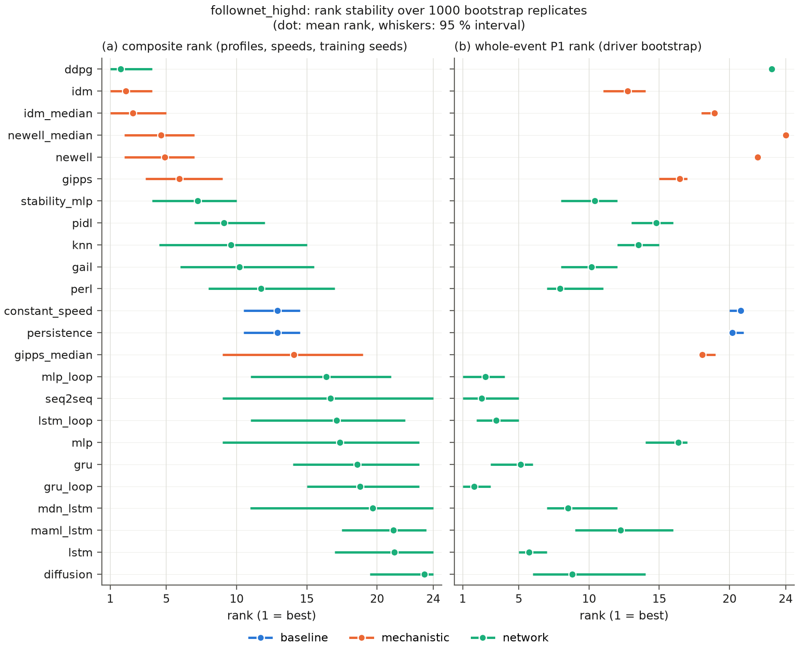
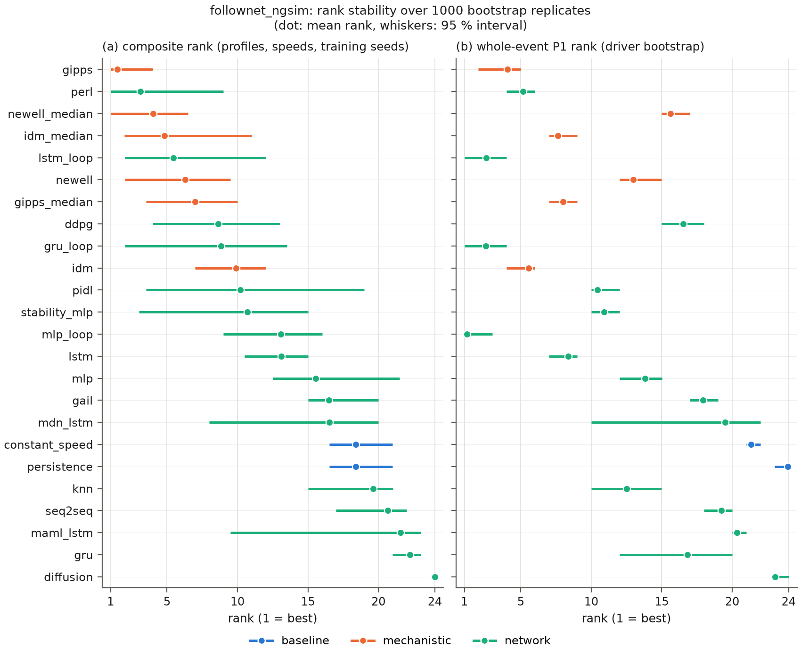
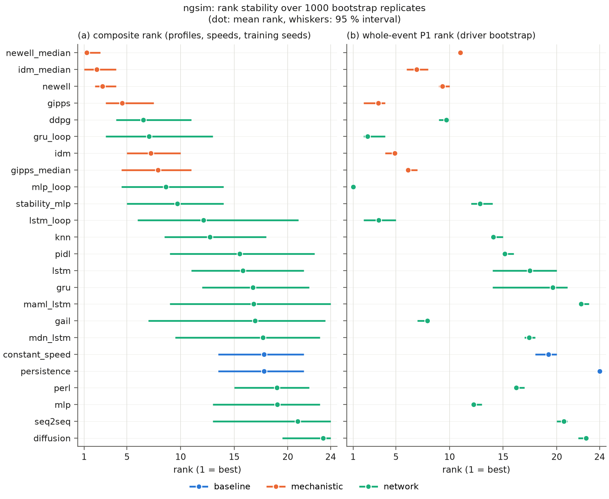
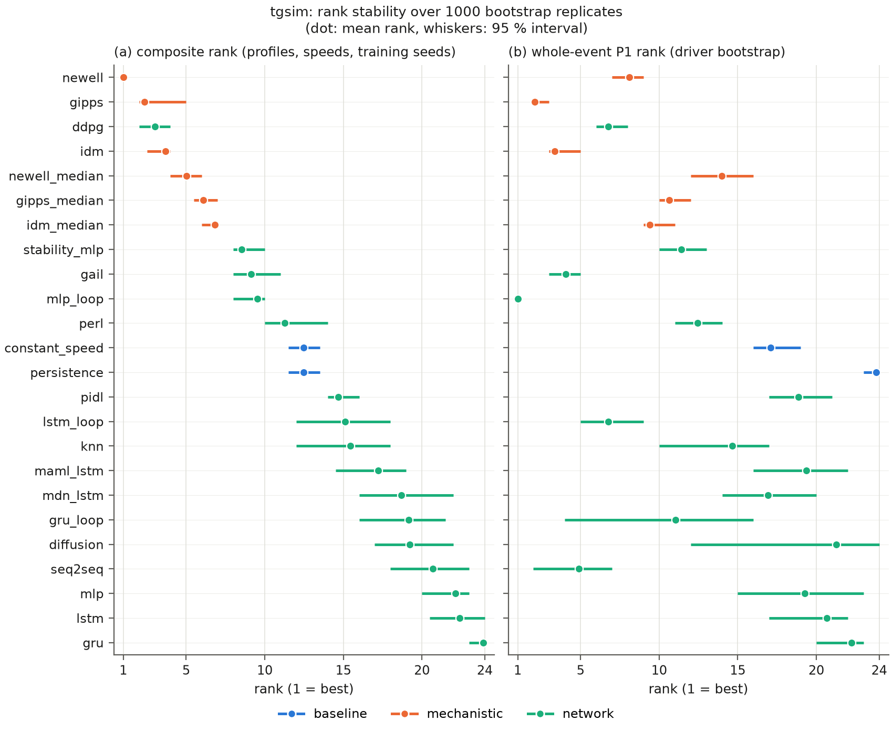
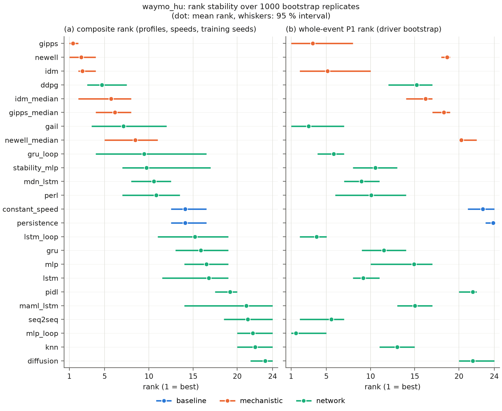

# FollowNet-2 leaderboard

Generated by `scripts/make_leaderboard.py` from `results/models` on 2026-10-12; definitions in `docs/leaderboard.md`, the checklist in `docs/checklist.md`. 3 decimals, `n/a` = not available.

## Summary

| dataset | ranked entries admitted | refused | driver leak (event split) | run directories (refused) | ranked by | top three |
|---|---|---|---|---|---|---|
| follownet_highd | 29 | 0 | - | 173 (0) | composite | ddpg, idm, idm_median |
| follownet_ngsim | 24 | 0 | - | 24 (0) | composite | gipps, perl, lstm_loop |
| ngsim | 33 | 0 | 8 admitted, 0 refused | 275 (0) | composite | newell_median, newell, idm_median |
| openacc | 24 | 0 | 8 admitted, 0 refused | 122 (0) | composite | newell, idm_median, gipps |
| tgsim | 24 | 0 | - | 24 (0) | composite | newell, gipps, ddpg |
| waymo_hu | 24 | 0 | - | 24 (0) | composite | gipps, idm, newell |

## follownet_highd

Ranked entries (driver split, fold 0, seed 0): **29 admitted, 0 refused**; no run under the `event` split; run directories validated: 173, refused 0.

### Main table

Sorted by the composite (lower is better), then by the whole-event P1 spacing error. `[low, high]`: 95 % intervals over 1000 replicates (seed 0): driver bootstrap with common random numbers across models for P0 and P1 (per-event tables that reproduce their JSON summary), bootstrap over the in-range P2 profiles, the P3 speeds with an equilibrium and the training seeds for the composite rank (the rank of the seed-0 composite, average ranks on ties). P0 ratio: RMSE_a(model) / RMSE_a(persistence). `*`: in-range values (P2 over the OpenACC profiles inside the 1-99 % speed range of the training data and the pulse, P4 over the synthetic scenarios inside it). P3: numerical unstable fraction at 0.05 m/s (at 1 m/s in parentheses) over the speeds with an equilibrium (n/a: none). Seed spread: min-max over the training seeds. Fold spread: min-max over the clean arms of the paired split (probe events; the P0 ratio against persistence on the same events).

| model | family | P0 ratio [95% CI] | P1 10 s RMSE_s (m) [95% CI] | P1 whole RMSE_s (m) [95% CI] | P1 whole collision rate | P2 concave-growth error\* | P2 hysteresis error\* | P2 collisions_100\* | P3 unstable fraction (1 m/s) | P4 collision rate synthetic\* / empirical | composite | composite rank [95% CI] | composite v2 | rank v2 | P0 ratio seed spread | P1 whole seed spread (m) | P0 ratio fold spread | P1 whole fold spread (m) |
|---|---|---|---|---|---|---|---|---|---|---|---|---|---|---|---|---|---|---|
| ddpg | network | 141.765 [136.592, 147.673] | 10.937 [10.560, 11.316] | 11.583 [11.159, 12.013] | 0.000 | 0.638 | 273.767 | 433 | 0.056 (0.056) | 0.000 / 0.176 | 0.130 | 1 [1.0, 4.0] | 0.413 | 5 | [123.796, 141.765] | [11.099, 11.583] | [138.862, 147.547] | [11.551, 11.814] |
| idm | mechanistic | 49.786 [46.594, 53.382] | 3.271 [3.107, 3.448] | 4.005 [3.784, 4.259] | 0.000 | 0.753 | 332.468 | 0 | 0.640 (0.720) | 0.000 / 0.015 | 0.158 | 2 [1.0, 4.0] | 0.207 | 1 | [48.162, 51.964] | [4.005, 4.036] | [48.233, 56.217] | [3.858, 4.098] |
| idm_median | mechanistic | 39.747 [37.306, 42.636] | 6.119 [5.929, 6.292] | 7.463 [7.228, 7.682] | 0.000 | 0.470 | 226.678 | 81 | 1.000 (1.000) | 0.000 / 0.027 | 0.185 | 3 [1.0, 5.0] | 0.370 | 2 | [35.147, 39.747] | [7.282, 7.463] | [34.428, 40.296] | [7.159, 7.745] |
| newell | mechanistic | 297.790 [287.233, 309.938] | 9.699 [9.371, 10.022] | 10.561 [10.221, 10.900] | 0.004 | 0.744 | 639.972 | 713 | 0.000 (0.947) | 0.000 / 0.195 | 0.288 | 4.5 [2.0, 7.0] | 0.482 | 13 | [297.790, 313.532] | [10.561, 11.255] | [288.892, 301.584] | [10.561, 11.228] |
| newell_median | mechanistic | 321.158 [309.175, 334.551] | 12.674 [12.252, 13.129] | 13.589 [13.136, 14.076] | 0.006 | 0.877 | 407.323 | 636 | 0.000 (1.000) | 0.000 / 0.283 | 0.288 | 4.5 [2.0, 7.0] | 0.453 | 9.5 | [315.350, 321.158] | [13.053, 13.589] | [302.536, 321.158] | [12.886, 13.589] |
| gipps | mechanistic | 164.014 [157.873, 170.842] | 3.578 [3.417, 3.744] | 4.317 [4.122, 4.539] | 0.000 | 0.873 | 403.923 | 0 | 1.000 (1.000) | 0.000 / 0.026 | 0.299 | 6 [3.5, 9.0] | 0.460 | 11 | [163.335, 186.483] | [4.295, 4.317] | [164.014, 177.840] | [4.201, 4.394] |
| gail | network | 15.882 [15.343, 16.464] | 3.082 [2.961, 3.205] | 3.809 [3.670, 3.954] | 0.003 | 0.859 | 297.175 | 816 | 1.000 (1.000) | 0.300 / 0.054 | 0.370 | 7 [6.0, 15.5] | 0.384 | 3 | [15.882, 19.654] | [3.689, 4.356] | [15.882, 18.292] | [3.809, 4.379] |
| stability_mlp | network | 15.296 [14.931, 15.672] | 3.080 [2.932, 3.223] | 3.827 [3.642, 4.011] | 0.004 | 0.889 | 474.700 | 848 | 0.762 (0.762) | 0.000 / 0.067 | 0.402 | 8.5 [4.0, 10.0] | 0.391 | 4 | [15.255, 15.317] | [3.827, 3.874] | [15.296, 15.735] | [3.827, 4.202] |
| knn | network | 15.959 [15.575, 16.345] | 3.242 [3.076, 3.421] | 4.053 [3.829, 4.303] | 0.007 | 0.752 | 489.346 | 781 | 1.000 (1.000) | 0.600 / 0.117 | 0.402 | 8.5 [4.5, 15.0] | 0.442 | 6.5 | [15.897, 15.998] | [4.048, 4.053] | [15.900, 16.275] | [4.053, 4.382] |
| pidl | network | 16.134 [15.695, 16.589] | 3.310 [3.144, 3.478] | 4.121 [3.905, 4.351] | 0.001 | 0.707 | 535.624 | 821 | 1.000 (1.000) | 0.000 / 0.063 | 0.424 | 10 [7.0, 12.0] | 0.442 | 6.5 | [16.134, 16.152] | [4.110, 4.156] | [16.134, 19.104] | [4.121, 9.538] |
| seq2seq | network | 5.270 [5.146, 5.396] | 2.467 [2.331, 2.611] | 3.159 [2.977, 3.349] | 0.003 | 0.658 | 797.862 | 62 | n/a | 0.000 / 0.161 | 0.440 | 11 [9.0, 24.0] | 0.453 | 9.5 | [5.226, 5.285] | [3.136, 3.159] | [5.231, 5.350] | [3.127, 3.548] |
| perl | network | 3.697 [3.546, 3.878] | 2.787 [2.610, 2.966] | 3.626 [3.392, 3.866] | 0.000 | 0.986 | 2596.191 | 181 | 1.000 (1.000) | 0.000 / 0.016 | 0.478 | 12 [8.0, 17.0] | 0.464 | 12 | [3.697, 3.987] | [3.559, 3.626] | [3.697, 4.264] | [3.540, 3.870] |
| persistence | baseline | 1.000 [1.000, 1.000] | 6.062 [5.711, 6.423] | 8.939 [8.431, 9.448] | 0.077 | 3.211 | 318.892 | 16 | n/a | 0.600 / 0.319 | 0.533 | 13.5 [10.5, 14.5] | 0.518 | 16 | [1.000, 1.000] | [8.939, 8.939] | [1.000, 1.000] | [8.939, 9.598] |
| constant_speed | baseline | 18.954 [18.494, 19.440] | 6.844 [6.451, 7.288] | 9.179 [8.656, 9.750] | 0.133 | 3.211 | 318.892 | 16 | n/a | 0.600 / 0.335 | 0.533 | 13.5 [10.5, 14.5] | 0.525 | 17 | [18.954, 18.954] | [9.179, 9.179] | [18.954, 19.369] | [9.179, 9.869] |
| gipps_median | mechanistic | 158.597 [153.329, 164.468] | 6.112 [5.897, 6.313] | 7.311 [7.070, 7.536] | 0.004 | 1.275 | 498.873 | 1123 | 1.000 (1.000) | 0.100 / 0.099 | 0.587 | 15 [9.0, 19.0] | 0.638 | 20 | [156.102, 160.036] | [7.300, 7.756] | [154.500, 158.597] | [6.962, 7.859] |
| lstm_loop | network | 5.589 [5.459, 5.729] | 2.507 [2.387, 2.628] | 3.196 [3.047, 3.361] | 0.002 | 0.857 | 3605.374 | 1445 | 1.000 (0.933) | 0.300 / 0.173 | 0.598 | 16 [11.0, 22.0] | 0.486 | 14 | [5.480, 5.868] | [3.172, 3.248] | [5.467, 5.660] | [3.111, 3.374] |
| mlp_loop | network | 2.844 [2.778, 2.910] | 2.485 [2.368, 2.621] | 3.166 [3.021, 3.331] | 0.004 | 1.183 | 2621.832 | 1435 | 1.000 (1.000) | 0.300 / 0.139 | 0.641 | 17 [11.0, 21.0] | 0.449 | 8 | [2.732, 2.844] | [3.142, 3.167] | [2.840, 2.895] | [3.166, 3.360] |
| gru_loop | network | 5.245 [5.126, 5.367] | 2.465 [2.354, 2.591] | 3.143 [2.998, 3.309] | 0.002 | 1.718 | 5777.205 | 1076 | 1.000 (1.000) | 0.100 / 0.280 | 0.685 | 18 [15.0, 23.0] | 0.500 | 15 | [5.245, 5.416] | [3.132, 3.158] | [5.087, 5.245] | [3.106, 3.333] |
| gru | network | 4.051 [3.978, 4.117] | 2.550 [2.419, 2.701] | 3.278 [3.115, 3.469] | 0.002 | 1.241 | 4375.041 | 1794 | 1.000 (1.000) | 0.300 / 0.239 | 0.717 | 19 [14.0, 23.0] | 0.543 | 19 | [4.051, 4.241] | [3.243, 3.326] | [3.999, 4.128] | [3.278, 3.544] |
| mdn_lstm | network | 5.368 [5.128, 5.617] | 2.860 [2.620, 3.133] | 3.670 [3.358, 4.005] | 0.005 | 2.038 | 14115.924 | 941 | 1.000 (1.000) | 0.600 / 0.132 | 0.739 | 20 [11.0, 24.0] | 0.703 | 22 | [4.843, 5.750] | [3.439, 4.416] | [5.313, 5.665] | [3.580, 4.313] |
| lstm | network | 4.486 [4.399, 4.571] | 2.548 [2.433, 2.672] | 3.306 [3.150, 3.466] | 0.001 | 1.932 | 5540.774 | 1768 | 1.000 (1.000) | 0.300 / 0.201 | 0.750 | 21.5 [17.0, 24.0] | 0.536 | 18 | [4.148, 4.791] | [3.276, 3.385] | [4.337, 4.547] | [3.296, 3.445] |
| mlp | network | 2.460 [2.395, 2.526] | 3.259 [3.109, 3.425] | 4.308 [4.105, 4.518] | 0.007 | 1.963 | 6759.803 | 1387 | 1.000 (1.000) | 0.300 / 0.200 | 0.750 | 21.5 [9.0, 23.0] | 0.717 | 23 | [2.328, 2.680] | [4.285, 4.700] | [2.450, 2.526] | [4.291, 4.676] |
| maml_lstm | network | 13.031 [12.514, 13.594] | 2.986 [2.722, 3.274] | 3.955 [3.551, 4.375] | 0.005 | 2.138 | 6323.754 | 1579 | 1.000 (1.000) | 0.300 / 0.163 | 0.793 | 23 [17.5, 23.5] | 0.696 | 21 | [12.910, 13.044] | [3.924, 3.991] | [12.785, 13.132] | [3.955, 4.338] |
| diffusion | network | 3.388 [2.998, 3.747] | 2.844 [2.526, 3.231] | 3.677 [3.265, 4.178] | 0.006 | 5.890 | 37828.422 | 211 | n/a | 0.000 / 0.200 | 0.810 | 24 [19.5, 24.0] | 0.728 | 24 | [3.217, 4.815] | [3.677, 5.172] | [3.388, 3.698] | [3.395, 4.204] |

Notes:

* Composite rank interval: 1000 replicates over the in-range P2 profiles, the P3 speeds with an equilibrium and the training seeds (in every replicate each model takes one of its admitted runs with P2/P3 tables at random: seeds 0-2, more than one seed for 24 of 24 models); the composite and its rank are those of seed 0.
* Composite v2 (columns `composite v2`, `rank v2`; the table stays sorted by the composite above): the mean normalised rank of six inputs, the four of the composite (P2 concave-growth and hysteresis errors, P3 unstable fraction, P2 collisions_100) plus two realism inputs, the whole-event P1 spacing RMSE and the relative fundamental-diagram error of P2 (`fd_error_rel`, pooled over the samples of all P2 profiles); equal weights, average ranks on ties, a missing value last, over the same models as the composite; rank 1 = best.

*Rank stability*: composite rank and whole-event P1 rank of every admitted model over 1000 replicates (dot: mean rank, whiskers: 95 % interval).

### Driver leak (event split)

No admitted run under the `event` split.

### Transfer

Relative degradation `rmse_s(A -> B) / rmse_s(B -> B)` of the whole event (A: this dataset, B: the target; 1 = no loss) with 95 % driver-bootstrap intervals over the test drivers of B, and its mean over the targets with a ratio. Only admitted entries; the ratio is left out when the run trained on B is not admitted.

| model | family | -> follownet_ngsim | -> ngsim | -> openacc | -> tgsim | -> waymo_hu | mean |
|---|---|---|---|---|---|---|---|
| ddpg | network | 0.950 [0.946, 0.955] | 1.024 [1.021, 1.026] | 1.023 [1.018, 1.024] | 1.008 [1.006, 1.010] | 0.990 [0.939, 1.045] | 0.999 |
| idm | mechanistic | 1.740 [1.544, 1.942] | 3.235 [3.013, 3.451] | 4.261 [3.541, 5.255] | 1.652 [1.535, 1.768] | 2.277 [1.730, 2.852] | 2.633 |
| idm_median | mechanistic | 1.559 [1.488, 1.639] | 1.347 [1.308, 1.388] | 1.329 [1.256, 1.478] | 0.381 [0.310, 0.511] | 1.096 [0.858, 1.435] | 1.143 |
| newell | mechanistic | 1.227 [1.147, 1.309] | 1.088 [1.058, 1.118] | 7.148 [1.650, 12.082] | 2.211 [1.704, 2.702] | 1.177 [1.029, 1.285] | 2.570 |
| newell_median | mechanistic | 1.026 [0.915, 1.157] | 0.999 [0.961, 1.040] | 1.280 [1.248, 1.535] | 0.419 [0.351, 0.510] | 0.773 [0.725, 0.857] | 0.899 |
| gipps | mechanistic | 1.335 [1.231, 1.458] | 2.300 [2.137, 2.460] | 5.819 [3.732, 7.455] | 1.815 [1.537, 2.120] | 2.378 [1.820, 3.059] | 2.729 |
| gail | network | 0.423 [0.384, 0.465] | 0.940 [0.919, 0.963] | 0.832 [0.730, 1.148] | 1.081 [0.996, 1.182] | 1.209 [1.023, 1.466] | 0.897 |
| stability_mlp | network | 1.193 [1.103, 1.295] | 1.628 [1.577, 1.679] | 2.458 [1.735, 2.908] | 0.279 [0.214, 0.424] | 1.462 [1.302, 1.593] | 1.404 |
| knn | network | 1.569 [1.310, 1.838] | 2.334 [2.195, 2.468] | 2.592 [2.012, 3.530] | 0.193 [0.134, 0.615] | 1.694 [1.403, 1.939] | 1.676 |
| pidl | network | 1.579 [1.454, 1.703] | 1.698 [1.643, 1.750] | 0.451 [0.370, 0.484] | 0.064 [0.048, 0.093] | 0.481 [0.399, 0.553] | 0.855 |
| seq2seq | network | 0.601 [0.553, 0.653] | 0.101 [0.096, 0.106] | 10.661 [4.223, 14.426] | 3.432 [1.862, 5.704] | 1.729 [1.450, 2.120] | 3.305 |
| perl | network | 2.995 [2.533, 3.440] | 2.067 [1.728, 2.489] | 2.276 [1.899, 2.870] | 0.738 [0.551, 0.980] | 2.074 [1.686, 2.556] | 2.030 |
| persistence | baseline | 1.000 [1.000, 1.000] | 1.000 [1.000, 1.000] | 1.000 [1.000, 1.000] | 1.000 [1.000, 1.000] | 1.000 [1.000, 1.000] | 1.000 |
| constant_speed | baseline | 1.000 [1.000, 1.000] | 1.000 [1.000, 1.000] | 1.000 [1.000, 1.000] | 1.000 [1.000, 1.000] | 1.000 [1.000, 1.000] | 1.000 |
| gipps_median | mechanistic | 1.742 [1.639, 1.850] | 1.392 [1.360, 1.426] | 1.888 [1.819, 1.983] | 0.658 [0.595, 0.730] | 0.915 [0.795, 1.122] | 1.319 |
| lstm_loop | network | 1.453 [1.354, 1.556] | 1.438 [1.182, 1.834] | 6.127 [4.934, 7.022] | 4.291 [1.069, 7.924] | 1.486 [1.195, 1.828] | 2.959 |
| mlp_loop | network | 1.778 [1.650, 1.917] | 1.550 [1.499, 1.609] | 4.082 [2.889, 4.672] | 3.216 [1.678, 4.793] | 1.417 [1.254, 1.663] | 2.409 |
| gru_loop | network | 1.717 [1.522, 1.938] | 3.867 [3.412, 4.333] | 5.548 [4.251, 7.870] | 0.818 [0.415, 5.967] | 1.733 [1.342, 2.189] | 2.737 |
| gru | network | 2.502 [1.655, 4.535] | 0.280 [0.189, 3.695] | 10.410 [3.778, 27.834] | 0.171 [0.065, 0.509] | 1.501 [1.174, 1.918] | 2.973 |
| mdn_lstm | network | 0.085 [0.039, 1.494] | 0.144 [0.106, 0.229] | 7.539 [4.085, 10.616] | 0.210 [0.082, 0.641] | 1.506 [1.051, 1.838] | 1.897 |
| lstm | network | 1.365 [1.229, 1.515] | 0.116 [0.066, 0.931] | 2.910 [2.320, 3.513] | 0.118 [0.028, 0.634] | 1.425 [1.180, 1.621] | 1.187 |
| mlp | network | 2.410 [1.705, 3.163] | 2.586 [2.334, 2.866] | 1.922 [1.597, 2.234] | 0.112 [0.056, 0.651] | 1.156 [1.014, 1.335] | 1.637 |
| maml_lstm | network | 8.824 [1.119, 17.579] | 0.542 [0.328, 0.811] | 1.427 [1.319, 1.693] | 0.850 [0.599, 0.975] | 1.327 [1.165, 1.482] | 2.594 |
| diffusion | network | 0.107 [0.063, 0.230] | 0.219 [0.177, 0.297] | 4.733 [3.384, 6.345] | 0.106 [0.038, 3.660] | 0.587 [0.391, 0.983] | 1.150 |

### Refused entries

None: every run directory of the dataset has a complete checklist.

### Provenance

* **data version**: reconstructed
* **reconstruction method**: qp-semi-implicit-v1
* **split**: driver, fold 0, training seed 0 (checklist split type: driver)
* **seeds**: checklist: global 0, split 0, train 0; seed spread: training seeds 0-2; fold spread: clean arms of folds 1-4
* **git revision of the runs**: training: d22e57347fa67c023ea3e8c0315e2a4093772485 (24), d9e4216c0c272b1791d23f1555fd469c3d868885 (5); protocols: e893976d6339ecb382deb0e0444e725fec4f3324 (66), d22e57347fa67c023ea3e8c0315e2a4093772485 (48), d9e4216c0c272b1791d23f1555fd469c3d868885 (44), 17f6bf4a0336865369fa4a0cf670154e40285698 (42), c9c11ba50d557fd8d24b34eafbb9af856c337c1a (36)
* **protocol configuration hashes**: p1: e742be505ac0; p1_follownet_ngsim: 6c82837f4191; p1_ngsim: 9de8b9140df1; p1_openacc: 9d5ebbb23d7b; p1_tgsim: 31f832d3b61a; p1_waymo_hu: cd1e81ad64a8; p2: 2f433d8a62f2; p3: 3b53e6f91840; p4: 0c38ee36eafd
* **bootstrap**: 1000 replicates, seed 0: drivers for P0 and P1 (common random numbers), in-range P2 profiles, P3 speeds with an equilibrium and training seeds for the composite rank (Generator [0, 1])
* **date**: 2026-10-12

## follownet_ngsim

Ranked entries (driver split, fold 0, seed 0): **24 admitted, 0 refused**; no run under the `event` split; run directories validated: 24, refused 0.

### Main table

Sorted by the composite (lower is better), then by the whole-event P1 spacing error. `[low, high]`: 95 % intervals over 1000 replicates (seed 0): driver bootstrap with common random numbers across models for P0 and P1 (per-event tables that reproduce their JSON summary), bootstrap over the in-range P2 profiles, the P3 speeds with an equilibrium and the training seeds for the composite rank (the rank of the seed-0 composite, average ranks on ties). P0 ratio: RMSE_a(model) / RMSE_a(persistence). `*`: in-range values (P2 over the OpenACC profiles inside the 1-99 % speed range of the training data and the pulse, P4 over the synthetic scenarios inside it). P3: numerical unstable fraction at 0.05 m/s (at 1 m/s in parentheses) over the speeds with an equilibrium (n/a: none).

| model | family | P0 ratio [95% CI] | P1 10 s RMSE_s (m) [95% CI] | P1 30 s RMSE_s (m) [95% CI] | P1 whole RMSE_s (m) [95% CI] | P1 whole collision rate | P2 concave-growth error\* | P2 hysteresis error\* | P2 collisions_100\* | P3 unstable fraction (1 m/s) | P4 collision rate synthetic\* / empirical | composite | composite rank [95% CI] | composite v2 | rank v2 |
|---|---|---|---|---|---|---|---|---|---|---|---|---|---|---|---|
| gipps | mechanistic | 35.970 [35.261, 36.746] | 3.259 [3.035, 3.537] | 5.038 [4.335, 5.893] | 5.597 [5.083, 6.213] | 0.000 | 0.595 | 176.518 | 0 | 0.000 (0.000) | 0.000 / 0.044 | 0.250 | 1 [1.0, 4.0] | 0.196 | 1 |
| perl | network | 1.544 [1.513, 1.580] | 2.901 [2.749, 3.051] | 4.515 [4.121, 4.942] | 5.767 [5.352, 6.202] | 0.000 | 0.428 | 131.000 | 37 | 0.957 (0.913) | 0.000 / 0.034 | 0.283 | 2 [1.0, 9.0] | 0.319 | 5.5 |
| lstm_loop | network | 1.768 [1.742, 1.796] | 2.652 [2.495, 2.811] | 4.225 [3.810, 4.640] | 5.305 [4.900, 5.754] | 0.000 | 0.472 | 143.763 | 90 | 0.867 (0.867) | 0.200 / 0.191 | 0.315 | 3 [2.0, 12.0] | 0.362 | 10.5 |
| idm_median | mechanistic | 10.288 [9.585, 11.017] | 4.328 [4.018, 4.693] | 5.919 [4.963, 7.036] | 6.475 [5.832, 7.215] | 0.000 | 0.622 | 177.972 | 0 | 0.529 (0.529) | 0.000 / 0.015 | 0.321 | 4 [2.0, 11.0] | 0.293 | 2 |
| newell_median | mechanistic | 46.802 [45.462, 48.193] | 8.596 [7.769, 9.472] | 6.608 [5.676, 7.755] | 11.518 [10.197, 12.848] | 0.000 | 0.996 | 170.467 | 0 | 0.000 (1.000) | 0.000 / 0.077 | 0.326 | 5 [1.0, 6.5] | 0.319 | 5.5 |
| newell | mechanistic | 50.072 [48.610, 51.517] | 7.693 [7.197, 8.273] | 6.942 [6.185, 7.872] | 8.530 [7.874, 9.272] | 0.000 | 0.897 | 182.395 | 0 | 0.000 (0.923) | 0.000 / 0.078 | 0.337 | 6 [2.0, 9.5] | 0.333 | 7 |
| gru_loop | network | 1.613 [1.591, 1.636] | 2.554 [2.422, 2.698] | 4.289 [3.852, 4.745] | 5.307 [4.888, 5.736] | 0.000 | 0.524 | 138.131 | 244 | 0.846 (0.769) | 0.000 / 0.185 | 0.348 | 7.5 [2.0, 13.5] | 0.362 | 10.5 |
| gipps_median | mechanistic | 39.361 [38.283, 40.486] | 4.125 [3.854, 4.425] | 5.814 [4.884, 6.927] | 6.505 [5.872, 7.226] | 0.000 | 0.684 | 191.212 | 0 | 0.000 (0.133) | 0.000 / 0.029 | 0.348 | 7.5 [3.5, 10.0] | 0.297 | 3 |
| ddpg | network | 22.031 [21.611, 22.555] | 9.744 [9.148, 10.348] | 10.876 [9.881, 12.002] | 12.361 [11.546, 13.191] | 0.000 | 0.666 | 195.252 | 0 | 0.000 (0.000) | 0.000 / 0.186 | 0.359 | 9 [4.0, 13.0] | 0.428 | 13 |
| pidl | network | 5.534 [5.458, 5.607] | 3.587 [3.419, 3.756] | 6.080 [5.488, 6.768] | 7.503 [7.013, 8.022] | 0.000 | 0.396 | 127.185 | 261 | 1.000 (1.000) | 0.000 / 0.011 | 0.364 | 10 [3.5, 19.0] | 0.351 | 8 |
| idm | mechanistic | 10.642 [10.040, 11.293] | 3.258 [3.079, 3.469] | 5.295 [4.499, 6.319] | 5.820 [5.253, 6.506] | 0.000 | 0.696 | 193.228 | 0 | 0.000 (0.000) | 0.000 / 0.013 | 0.370 | 11.5 [7.0, 12.0] | 0.312 | 4 |
| stability_mlp | network | 5.467 [5.400, 5.530] | 3.450 [3.287, 3.617] | 5.620 [5.217, 6.028] | 7.601 [7.061, 8.159] | 0.008 | 0.401 | 170.248 | 566 | 0.500 (0.938) | 0.600 / 0.054 | 0.370 | 11.5 [3.0, 15.0] | 0.391 | 12 |
| lstm | network | 1.289 [1.269, 1.312] | 3.192 [2.876, 3.556] | 4.785 [4.363, 5.234] | 6.691 [6.005, 7.451] | 0.003 | 0.556 | 148.349 | 195 | 1.000 (0.941) | 0.800 / 0.293 | 0.451 | 13 [10.5, 15.0] | 0.489 | 14 |
| mlp_loop | network | 1.246 [1.230, 1.265] | 2.534 [2.405, 2.678] | 4.196 [3.730, 4.723] | 5.164 [4.724, 5.666] | 0.000 | 0.480 | 146.611 | 287 | 1.000 (1.000) | 0.000 / 0.052 | 0.462 | 14 [9.0, 16.0] | 0.359 | 9 |
| mlp | network | 0.988 [0.972, 1.006] | 3.448 [3.268, 3.638] | 6.602 [5.866, 7.314] | 9.031 [7.888, 10.250] | 0.037 | 0.364 | 186.075 | 850 | 1.000 (1.000) | 0.600 / 0.150 | 0.549 | 15 [12.5, 21.5] | 0.518 | 15 |
| gail | network | 4.564 [4.501, 4.624] | 4.090 [3.908, 4.291] | 9.097 [8.394, 9.797] | 14.069 [13.239, 14.967] | 0.000 | 0.839 | 306.891 | 0 | n/a | 0.000 / 0.042 | 0.614 | 16 [15.0, 20.0] | 0.598 | 16 |
| mdn_lstm | network | 1.582 [1.545, 1.627] | 3.244 [2.972, 3.524] | 36.578 [4.777, 64.734] | 115.735 [7.250, 202.084] | 0.008 | 12.236 | 320393.411 | 62 | 0.636 (0.636) | 0.800 / 0.279 | 0.641 | 17 [8.0, 20.0] | 0.717 | 20 |
| constant_speed | baseline | 5.986 [5.891, 6.081] | 9.141 [8.707, 9.576] | 45.119 [41.332, 48.961] | 80.752 [72.460, 88.791] | 0.533 | 1.468 | 188.776 | 10 | n/a | 0.600 / 0.335 | 0.668 | 18.5 [16.5, 21.0] | 0.681 | 18 |
| persistence | baseline | 1.000 [1.000, 1.000] | 16.532 [15.813, 17.287] | 135.959 [116.613, 154.873] | 334.760 [262.755, 410.286] | 0.350 | 1.468 | 188.776 | 10 | n/a | 0.600 / 0.319 | 0.668 | 18.5 [16.5, 21.0] | 0.703 | 19 |
| knn | network | 5.639 [5.570, 5.704] | 3.672 [3.497, 3.863] | 5.964 [5.418, 6.693] | 8.395 [7.274, 9.976] | 0.010 | 0.574 | 431.146 | 710 | 1.000 (1.000) | 0.600 / 0.081 | 0.701 | 20 [15.0, 21.0] | 0.670 | 17 |
| seq2seq | network | 3.241 [3.196, 3.291] | 4.033 [3.882, 4.212] | 13.400 [12.648, 14.131] | 17.204 [16.496, 17.944] | 0.005 | 0.910 | 3251.961 | 231 | 1.000 (1.000) | 0.000 / 0.149 | 0.712 | 21 [17.0, 22.0] | 0.757 | 21 |
| gru | network | 1.006 [0.990, 1.024] | 3.709 [3.136, 4.455] | 5.481 [4.905, 6.068] | 13.610 [7.649, 19.149] | 0.016 | 39.481 | 1333663.728 | 465 | 0.938 (0.750) | 0.600 / 0.326 | 0.793 | 22 [21.0, 23.0] | 0.804 | 22 |
| maml_lstm | network | 2.883 [2.813, 2.959] | 5.451 [5.121, 5.785] | 19.797 [13.933, 25.117] | 35.242 [24.749, 44.505] | 0.039 | 16.116 | 665330.305 | 540 | 1.000 (1.000) | 0.600 / 0.181 | 0.842 | 23 [9.5, 23.0] | 0.808 | 23 |
| diffusion | network | 0.791 [0.772, 0.811] | 11.278 [10.583, 12.089] | 85.604 [56.497, 122.237] | 219.284 [110.909, 328.966] | 0.175 | 220.380 | 10540145.602 | 603 | 1.000 (1.000) | 1.000 / 0.262 | 0.908 | 24 [24.0, 24.0] | 0.931 | 24 |

Notes:

* Composite rank interval: 1000 replicates over the in-range P2 profiles, the P3 speeds with an equilibrium and the training seeds (in every replicate each model takes one of its admitted runs with P2/P3 tables at random: seeds 0, more than one seed for 0 of 24 models); the composite and its rank are those of seed 0.
* Composite v2 (columns `composite v2`, `rank v2`; the table stays sorted by the composite above): the mean normalised rank of six inputs, the four of the composite (P2 concave-growth and hysteresis errors, P3 unstable fraction, P2 collisions_100) plus two realism inputs, the whole-event P1 spacing RMSE and the relative fundamental-diagram error of P2 (`fd_error_rel`, pooled over the samples of all P2 profiles); equal weights, average ranks on ties, a missing value last, over the same models as the composite; rank 1 = best.

*Rank stability*: composite rank and whole-event P1 rank of every admitted model over 1000 replicates (dot: mean rank, whiskers: 95 % interval).

### Driver leak (event split)

No admitted run under the `event` split.

### Transfer

Relative degradation `rmse_s(A -> B) / rmse_s(B -> B)` of the whole event (A: this dataset, B: the target; 1 = no loss) with 95 % driver-bootstrap intervals over the test drivers of B, and its mean over the targets with a ratio. Only admitted entries; the ratio is left out when the run trained on B is not admitted.

| model | family | -> follownet_highd | -> ngsim | -> openacc | -> tgsim | -> waymo_hu | mean |
|---|---|---|---|---|---|---|---|
| gipps | mechanistic | 1.322 [1.266, 1.375] | 1.180 [1.152, 1.212] | 8.160 [2.264, 11.667] | 2.935 [2.172, 3.653] | 1.759 [1.430, 2.184] | 3.071 |
| perl | network | 1.678 [1.569, 1.786] | 0.863 [0.619, 1.190] | 3.317 [2.248, 3.972] | 2.173 [0.475, 3.900] | 1.438 [1.129, 1.880] | 1.894 |
| lstm_loop | network | 3.000 [2.636, 3.390] | 1.258 [1.158, 1.427] | 54.235 [28.599, 74.381] | 67.861 [20.061, 125.239] | 5.111 [3.340, 6.993] | 26.293 |
| idm_median | mechanistic | 1.814 [1.747, 1.888] | 1.141 [1.108, 1.175] | 7.659 [2.003, 13.517] | 1.172 [1.146, 1.207] | 1.481 [1.317, 1.608] | 2.653 |
| newell_median | mechanistic | 4.118 [3.995, 4.247] | 1.318 [1.281, 1.356] | 2.921 [2.627, 7.727] | 1.311 [1.258, 1.351] | 1.749 [1.618, 1.980] | 2.283 |
| newell | mechanistic | 3.566 [3.452, 3.706] | 1.224 [1.198, 1.252] | 13.134 [4.943, 21.430] | 5.279 [3.820, 6.615] | 2.095 [1.663, 2.412] | 5.060 |
| gru_loop | network | 11.704 [10.936, 12.547] | 1.187 [1.148, 1.223] | 61.880 [50.900, 65.961] | 27.240 [5.990, 243.004] | 8.708 [5.504, 11.810] | 22.144 |
| gipps_median | mechanistic | 2.092 [2.014, 2.180] | 1.252 [1.220, 1.285] | 3.031 [2.823, 3.877] | 1.310 [1.225, 1.384] | 1.291 [1.194, 1.450] | 1.795 |
| ddpg | network | 1.038 [1.028, 1.049] | 1.070 [1.066, 1.074] | 1.125 [1.073, 1.185] | 1.048 [1.042, 1.055] | 1.033 [0.986, 1.067] | 1.063 |
| pidl | network | 1.150 [1.115, 1.187] | 0.995 [0.972, 1.018] | 0.371 [0.341, 0.383] | 0.143 [0.042, 0.267] | 0.409 [0.333, 0.477] | 0.614 |
| idm | mechanistic | 1.964 [1.852, 2.077] | 1.305 [1.268, 1.343] | 3.773 [1.315, 6.167] | 1.509 [1.316, 1.723] | 1.604 [1.363, 1.882] | 2.031 |
| stability_mlp | network | 1.111 [1.077, 1.148] | 1.680 [1.629, 1.732] | 2.338 [1.580, 2.857] | 0.281 [0.204, 0.442] | 1.549 [1.365, 1.696] | 1.392 |
| lstm | network | 5.186 [4.584, 5.820] | 1.005 [0.833, 5.297] | 41.677 [27.460, 78.644] | 2.874 [0.977, 14.157] | 8.573 [5.710, 11.703] | 11.863 |
| mlp_loop | network | 1.184 [1.119, 1.247] | 1.182 [1.158, 1.208] | 1.141 [0.981, 1.233] | 1.149 [1.084, 1.221] | 1.207 [1.039, 1.453] | 1.173 |
| mlp | network | 1.120 [1.057, 1.185] | 1.167 [1.095, 1.253] | 1.134 [0.481, 1.815] | 0.027 [0.016, 0.183] | 1.533 [1.060, 2.281] | 0.996 |
| gail | network | 1.939 [1.877, 2.004] | 3.737 [3.595, 3.883] | 1.856 [1.736, 2.606] | 2.959 [2.648, 3.293] | 2.376 [1.894, 2.980] | 2.573 |
| mdn_lstm | network | 14.653 [13.360, 16.014] | 3.439 [1.787, 5.970] | 69.954 [52.370, 86.758] | 6.619 [3.112, 14.492] | 10.951 [7.585, 14.628] | 21.123 |
| constant_speed | baseline | 1.000 [1.000, 1.000] | 1.000 [1.000, 1.000] | 1.000 [1.000, 1.000] | 1.000 [1.000, 1.000] | 1.000 [1.000, 1.000] | 1.000 |
| persistence | baseline | 1.000 [1.000, 1.000] | 1.000 [1.000, 1.000] | 1.000 [1.000, 1.000] | 1.000 [1.000, 1.000] | 1.000 [1.000, 1.000] | 1.000 |
| knn | network | 1.443 [1.378, 1.511] | 1.379 [1.285, 1.468] | 2.259 [1.614, 2.809] | 0.123 [0.082, 0.411] | 1.711 [1.302, 2.035] | 1.383 |
| seq2seq | network | 4.138 [3.824, 4.492] | 0.168 [0.160, 0.178] | 32.121 [21.145, 38.534] | 37.677 [16.392, 58.237] | 4.004 [2.981, 5.167] | 15.622 |
| gru | network | 13.974 [13.082, 14.905] | 0.809 [0.447, 10.652] | 37.230 [27.056, 93.771] | 1.816 [0.574, 5.187] | 10.690 [7.369, 14.312] | 12.904 |
| maml_lstm | network | 3.599 [3.198, 4.055] | 0.742 [0.458, 0.971] | 10.680 [7.647, 13.358] | 2.704 [1.394, 5.488] | 2.145 [1.038, 3.075] | 3.974 |
| diffusion | network | 17.110 [15.022, 19.305] | 3.891 [2.935, 5.607] | 19.130 [11.772, 84.226] | 3.453 [2.426, 96.256] | 3.111 [2.463, 4.753] | 9.339 |

### Refused entries

None: every run directory of the dataset has a complete checklist.

### Provenance

* **data version**: reconstructed
* **reconstruction method**: qp-semi-implicit-v1
* **split**: driver, fold 0, training seed 0 (checklist split type: driver)
* **seeds**: checklist: global 0, split 0, train 0; seed spread: none; fold spread: none
* **git revision of the runs**: training: d9e4216c0c272b1791d23f1555fd469c3d868885 (16), d22e57347fa67c023ea3e8c0315e2a4093772485 (8); protocols: d9e4216c0c272b1791d23f1555fd469c3d868885 (69), 83e3f28c96d3e46f151009e08a97151f6d89977e (50), d22e57347fa67c023ea3e8c0315e2a4093772485 (48), e893976d6339ecb382deb0e0444e725fec4f3324 (48), 4d2efee388bdcbbd23477459cf8548ccd746c2b5 (1)
* **protocol configuration hashes**: p1: e742be505ac0; p1_follownet_highd: 73bf244e536b; p1_ngsim: 9de8b9140df1; p1_openacc: 9d5ebbb23d7b; p1_tgsim: 31f832d3b61a; p1_waymo_hu: cd1e81ad64a8; p2: 2f433d8a62f2; p3: 3b53e6f91840; p4: 0c38ee36eafd
* **bootstrap**: 1000 replicates, seed 0: drivers for P0 and P1 (common random numbers), in-range P2 profiles, P3 speeds with an equilibrium and training seeds for the composite rank (Generator [0, 1])
* **date**: 2026-10-12

## ngsim

Ranked entries (driver split, fold 0, seed 0): **33 admitted, 0 refused**; driver leak (`event` split): 8 admitted and 0 refused runs, listed apart and never ranked; run directories validated: 275, refused 0.

### Main table

Sorted by the composite (lower is better), then by the whole-event P1 spacing error. `[low, high]`: 95 % intervals over 1000 replicates (seed 0): driver bootstrap with common random numbers across models for P0 and P1 (per-event tables that reproduce their JSON summary), bootstrap over the in-range P2 profiles, the P3 speeds with an equilibrium and the training seeds for the composite rank (the rank of the seed-0 composite, average ranks on ties). P0 ratio: RMSE_a(model) / RMSE_a(persistence). `*`: in-range values (P2 over the OpenACC profiles inside the 1-99 % speed range of the training data and the pulse, P4 over the synthetic scenarios inside it). P3: numerical unstable fraction at 0.05 m/s (at 1 m/s in parentheses) over the speeds with an equilibrium (n/a: none). Seed spread: min-max over the training seeds. Fold spread: min-max over the clean arms of the paired split (probe events; the P0 ratio against persistence on the same events).

| model | family | P0 ratio [95% CI] | P1 10 s RMSE_s (m) [95% CI] | P1 30 s RMSE_s (m) [95% CI] | P1 whole RMSE_s (m) [95% CI] | P1 whole collision rate | P2 concave-growth error\* | P2 hysteresis error\* | P2 collisions_100\* | P3 unstable fraction (1 m/s) | P4 collision rate synthetic\* / empirical | composite | composite rank [95% CI] | composite v2 | rank v2 | P0 ratio seed spread | P1 whole seed spread (m) | P0 ratio fold spread | P1 whole fold spread (m) |
|---|---|---|---|---|---|---|---|---|---|---|---|---|---|---|---|---|---|---|---|
| newell_median | mechanistic | 66.578 [65.472, 67.719] | 6.852 [6.653, 7.063] | 6.393 [6.080, 6.747] | 8.422 [8.029, 8.840] | 0.016 | 0.424 | 91.674 | 0 | 0.000 (0.909) | 0.000 / 0.182 | 0.125 | 1 [1.0, 2.5] | 0.156 | 1 | [64.849, 66.578] | [8.310, 8.501] | [64.913, 66.578] | [7.816, 8.422] |
| newell | mechanistic | 75.093 [73.968, 76.258] | 7.238 [7.048, 7.444] | 6.604 [6.321, 6.947] | 7.992 [7.671, 8.346] | 0.004 | 0.425 | 97.523 | 0 | 0.000 (0.000) | 0.000 / 0.134 | 0.168 | 2 [2.0, 4.0] | 0.192 | 2 | [73.443, 75.093] | [7.992, 8.365] | [73.388, 75.093] | [7.450, 7.992] |
| idm_median | mechanistic | 19.159 [18.527, 19.817] | 4.059 [3.948, 4.181] | 5.690 [5.375, 6.047] | 6.790 [6.490, 7.108] | 0.000 | 0.399 | 91.926 | 0 | 0.647 (0.588) | 0.000 / 0.034 | 0.174 | 3 [1.0, 4.0] | 0.196 | 3.5 | [18.890, 19.423] | [6.722, 6.963] | [18.123, 19.159] | [6.454, 6.790] |
| gipps | mechanistic | 54.254 [53.489, 55.071] | 3.333 [3.248, 3.426] | 4.825 [4.600, 5.108] | 5.990 [5.756, 6.264] | 0.000 | 0.440 | 91.339 | 0 | 0.875 (0.812) | 0.000 / 0.069 | 0.217 | 4 [3.0, 7.5] | 0.196 | 3.5 | [54.254, 55.148] | [5.982, 5.999] | [53.207, 54.254] | [5.754, 5.990] |
| ddpg | network | 27.193 [26.821, 27.630] | 6.264 [6.034, 6.498] | 6.825 [6.506, 7.208] | 8.045 [7.708, 8.405] | 0.000 | 0.474 | 105.085 | 0 | 0.423 (0.115) | 0.000 / 0.161 | 0.261 | 5 [4.0, 11.0] | 0.283 | 7 | [26.887, 28.508] | [8.045, 8.477] | [24.861, 28.438] | [7.907, 8.249] |
| mlp_loop | network | 1.637 [1.623, 1.653] | 2.483 [2.434, 2.537] | 4.453 [4.257, 4.666] | 5.639 [5.451, 5.848] | 0.013 | 0.374 | 77.624 | 548 | 1.000 (1.000) | 0.400 / 0.076 | 0.304 | 6 [4.5, 14.0] | 0.254 | 5 | [1.561, 1.637] | [5.585, 5.639] | [1.587, 1.637] | [5.414, 5.639] |
| gru_loop | network | 1.934 [1.916, 1.954] | 2.542 [2.494, 2.594] | 4.553 [4.360, 4.771] | 5.893 [5.670, 6.171] | 0.021 | 0.454 | 87.153 | 603 | 0.737 (0.579) | 0.000 / 0.272 | 0.337 | 7 [3.0, 13.0] | 0.370 | 9 | [1.934, 2.011] | [5.765, 5.946] | [1.873, 1.959] | [5.742, 29.063] |
| idm | mechanistic | 25.702 [24.983, 26.408] | 3.361 [3.286, 3.446] | 5.045 [4.817, 5.329] | 6.107 [5.867, 6.388] | 0.000 | 0.545 | 111.055 | 0 | 0.000 (0.000) | 0.000 / 0.025 | 0.342 | 8 [5.0, 10.0] | 0.272 | 6 | [24.731, 25.702] | [6.107, 6.125] | [22.808, 25.702] | [5.904, 6.107] |
| gipps_median | mechanistic | 62.259 [61.195, 63.336] | 4.354 [4.252, 4.464] | 5.665 [5.441, 5.956] | 6.719 [6.484, 6.993] | 0.000 | 0.613 | 112.638 | 0 | 0.000 (0.062) | 0.000 / 0.052 | 0.375 | 9 [4.5, 11.0] | 0.293 | 8 | [58.242, 62.259] | [6.719, 6.850] | [56.323, 62.259] | [6.414, 6.819] |
| lstm_loop | network | 2.297 [2.276, 2.319] | 2.601 [2.549, 2.656] | 4.704 [4.497, 4.926] | 5.979 [5.779, 6.185] | 0.016 | 0.451 | 83.432 | 659 | 1.000 (1.000) | 0.400 / 0.243 | 0.424 | 10 [6.0, 21.0] | 0.457 | 10 | [2.297, 2.641] | [5.979, 6.058] | [2.271, 2.371] | [5.807, 6.172] |
| stability_mlp | network | 7.420 [7.370, 7.471] | 3.582 [3.505, 3.664] | 7.466 [7.075, 7.880] | 9.972 [9.551, 10.398] | 0.181 | 0.534 | 110.675 | 281 | 0.346 (0.923) | 0.600 / 0.137 | 0.435 | 11 [5.0, 14.0] | 0.471 | 11 | [7.419, 7.421] | [9.519, 10.210] | [7.371, 7.420] | [9.590, 10.032] |
| knn | network | 7.608 [7.555, 7.662] | 3.817 [3.728, 3.909] | 8.708 [8.244, 9.216] | 11.126 [10.636, 11.650] | 0.211 | 0.503 | 95.048 | 560 | 1.000 (1.000) | 0.600 / 0.155 | 0.511 | 12 [8.5, 18.0] | 0.558 | 12 | [7.599, 7.608] | [10.313, 11.588] | [7.553, 7.608] | [9.460, 20.654] |
| maml_lstm | network | 3.376 [3.334, 3.417] | 6.665 [6.353, 7.001] | 59.640 [48.469, 71.405] | 261.404 [188.331, 323.127] | 0.254 | 0.397 | 121.135 | 774 | 1.000 (1.000) | 0.600 / 0.269 | 0.565 | 13 [9.0, 24.0] | 0.696 | 21 | [3.376, 3.440] | [261.404, 494.384] | [3.306, 3.392] | [251.149, 271.042] |
| pidl | network | 7.646 [7.573, 7.719] | 3.918 [3.805, 4.037] | 9.248 [8.672, 9.883] | 13.135 [12.401, 13.855] | 0.168 | 0.479 | 112.811 | 771 | 1.000 (1.000) | 0.400 / 0.076 | 0.620 | 14 [9.0, 22.5] | 0.594 | 13 | [7.640, 7.646] | [12.847, 13.135] | [7.548, 8.239] | [12.211, 139.110] |
| constant_speed | baseline | 8.365 [8.288, 8.450] | 9.546 [9.362, 9.744] | 46.735 [45.460, 48.139] | 118.790 [112.308, 125.617] | 0.560 | 0.998 | 110.534 | 8 | n/a | 0.600 / 0.335 | 0.625 | 15.5 [13.5, 21.5] | 0.616 | 14 | [8.365, 8.365] | [118.790, 118.790] | [8.307, 8.365] | [115.825, 122.563] |
| persistence | baseline | 1.000 [1.000, 1.000] | 14.556 [14.259, 14.863] | 127.213 [120.811, 133.080] | 827.895 [618.562, 1045.510] | 0.529 | 0.998 | 110.534 | 8 | n/a | 0.600 / 0.319 | 0.625 | 15.5 [13.5, 21.5] | 0.652 | 16 | [1.000, 1.000] | [827.895, 827.895] | [1.000, 1.000] | [827.473, 1105.225] |
| lstm | network | 1.296 [1.284, 1.310] | 3.073 [3.002, 3.155] | 13.974 [6.010, 20.940] | 81.568 [10.179, 140.603] | 0.119 | 0.519 | 307.913 | 716 | 0.933 (0.933) | 0.800 / 0.343 | 0.630 | 17 [11.0, 21.5] | 0.659 | 18.5 | [1.296, 1.468] | [64.455, 103.414] | [1.261, 1.312] | [21.482, 178.238] |
| perl | network | 1.582 [1.556, 1.611] | 3.108 [3.052, 3.173] | 9.659 [7.933, 11.424] | 16.147 [13.253, 19.257] | 0.009 | 1.412 | 2303.012 | 272 | 0.938 (0.688) | 0.400 / 0.150 | 0.663 | 18 [15.0, 22.0] | 0.681 | 20 | [1.513, 1.638] | [13.644, 16.147] | [1.474, 1.582] | [16.147, 33.582] |
| gru | network | 1.145 [1.137, 1.153] | 3.068 [3.004, 3.138] | 11.129 [6.146, 16.034] | 144.537 [10.718, 218.517] | 0.148 | 0.487 | 277.093 | 807 | 1.000 (1.000) | 0.800 / 0.357 | 0.685 | 19 [12.0, 22.0] | 0.739 | 22 | [1.145, 1.211] | [10.697, 144.537] | [1.132, 1.194] | [20.292, 144.537] |
| mdn_lstm | network | 1.757 [1.724, 1.793] | 3.553 [3.326, 3.826] | 14.154 [9.943, 18.638] | 54.980 [34.536, 72.600] | 0.083 | 1.621 | 4077.359 | 601 | 0.857 (0.857) | 1.000 / 0.351 | 0.707 | 20 [9.5, 23.0] | 0.645 | 15 | [1.623, 1.757] | [54.980, 192.527] | [1.730, 1.757] | [35.721, 76.894] |
| mlp | network | 1.032 [1.023, 1.042] | 4.109 [4.035, 4.189] | 8.019 [7.720, 8.390] | 9.787 [9.545, 10.054] | 0.165 | 0.495 | 345.087 | 860 | 1.000 (1.000) | 0.600 / 0.258 | 0.734 | 21 [13.0, 23.0] | 0.656 | 17 | [0.866, 1.032] | [9.599, 38.174] | [0.859, 1.032] | [9.385, 21.256] |
| gail | network | 6.683 [6.611, 6.752] | 3.200 [3.153, 3.258] | 5.745 [5.578, 5.929] | 7.015 [6.832, 7.213] | 0.236 | 0.605 | 113.534 | 998 | 1.000 (0.955) | 0.600 / 0.118 | 0.761 | 22 [7.0, 23.5] | 0.659 | 18.5 | [6.683, 7.588] | [7.015, 7.761] | [6.683, 8.650] | [6.746, 8.365] |
| seq2seq | network | 3.034 [3.007, 3.064] | 9.119 [9.016, 9.223] | 54.026 [53.066, 55.026] | 159.696 [155.550, 163.602] | 0.017 | 49.404 | 725282.407 | 40 | n/a | 0.000 / 0.161 | 0.837 | 23 [13.0, 24.0] | 0.855 | 24 | [3.034, 3.207] | [47.148, 159.696] | [2.968, 3.040] | [103.361, 159.696] |
| diffusion | network | 0.615 [0.568, 0.666] | 4.357 [4.116, 4.660] | 40.805 [32.387, 49.798] | 294.051 [214.484, 363.922] | 0.315 | 1.863 | 3037.587 | 860 | 1.000 (1.000) | 0.600 / 0.286 | 0.875 | 24 [19.5, 24.0] | 0.851 | 23 | [0.615, 0.628] | [213.051, 760.275] | [0.560, 1.131] | [10.932, 766.671] |

Notes:

* Composite rank interval: 1000 replicates over the in-range P2 profiles, the P3 speeds with an equilibrium and the training seeds (in every replicate each model takes one of its admitted runs with P2/P3 tables at random: seeds 0-2, more than one seed for 24 of 24 models); the composite and its rank are those of seed 0.
* Composite v2 (columns `composite v2`, `rank v2`; the table stays sorted by the composite above): the mean normalised rank of six inputs, the four of the composite (P2 concave-growth and hysteresis errors, P3 unstable fraction, P2 collisions_100) plus two realism inputs, the whole-event P1 spacing RMSE and the relative fundamental-diagram error of P2 (`fd_error_rel`, pooled over the samples of all P2 profiles); equal weights, average ranks on ties, a missing value last, over the same models as the composite; rank 1 = best.

*Rank stability*: composite rank and whole-event P1 rank of every admitted model over 1000 replicates (dot: mean rank, whiskers: 95 % interval).

### Driver leak (event split)

Runs under the `event` split share drivers between training and test (checklist rule 2): they are labelled "driver leak", listed apart and never ranked. Intervals: driver bootstrap over their own test part; the last column repeats the whole-event P1 error of the driver-split entry.

| model | family | label | run | P0 RMSE_a (m/s^2) [95% CI] | P1 10 s RMSE_s (m) [95% CI] | P1 30 s RMSE_s (m) [95% CI] | P1 whole RMSE_s (m) [95% CI] | P1 whole collision rate | P1 whole RMSE_s, driver split (m) |
|---|---|---|---|---|---|---|---|---|---|
| mlp_loop | network | driver leak | event-fold0/mlp_loop/seed0 | 0.147 [0.145, 0.149] | 2.515 [2.456, 2.574] | 4.404 [4.226, 4.585] | 5.659 [5.441, 5.893] | 0.011 | 5.639 |
| gipps | mechanistic | driver leak | event-fold0/gipps/seed0 | 4.733 [4.707, 4.761] | 3.279 [3.196, 3.377] | 4.788 [4.556, 5.060] | 5.957 [5.718, 6.241] | 0.000 | 5.990 |
| idm | mechanistic | driver leak | event-fold0/idm/seed0 | 2.269 [2.216, 2.323] | 3.346 [3.268, 3.428] | 5.072 [4.812, 5.350] | 6.153 [5.892, 6.442] | 0.000 | 6.107 |
| lstm_loop | network | driver leak | event-fold0/lstm_loop/seed0 | 0.207 [0.204, 0.210] | 2.640 [2.579, 2.707] | 4.585 [4.419, 4.758] | 6.169 [5.772, 6.709] | 0.014 | 5.979 |
| ddpg | network | driver leak | event-fold0/ddpg/seed0 | 2.503 [2.488, 2.518] | 6.559 [6.311, 6.821] | 6.938 [6.567, 7.334] | 8.386 [8.029, 8.800] | 0.001 | 8.045 |
| stability_mlp | network | driver leak | event-fold0/stability_mlp/seed0 | 0.666 [0.659, 0.673] | 3.582 [3.500, 3.666] | 7.565 [7.178, 8.017] | 10.143 [9.677, 10.577] | 0.184 | 9.972 |
| mlp | network | driver leak | event-fold0/mlp/seed0 | 0.098 [0.097, 0.099] | 5.019 [4.913, 5.129] | 14.778 [14.081, 15.459] | 25.045 [23.914, 26.240] | 0.372 | 9.787 |
| lstm | network | driver leak | event-fold0/lstm/seed0 | 0.115 [0.113, 0.116] | 3.174 [3.039, 3.362] | 16.764 [6.171, 26.947] | 43.947 [8.835, 74.782] | 0.108 | 81.568 |

### Transfer

Relative degradation `rmse_s(A -> B) / rmse_s(B -> B)` of the whole event (A: this dataset, B: the target; 1 = no loss) with 95 % driver-bootstrap intervals over the test drivers of B, and its mean over the targets with a ratio. Only admitted entries; the ratio is left out when the run trained on B is not admitted.

| model | family | -> follownet_highd | -> follownet_ngsim | -> openacc | -> tgsim | -> waymo_hu | mean |
|---|---|---|---|---|---|---|---|
| newell_median | mechanistic | 3.478 [3.375, 3.585] | 0.998 [0.938, 1.067] | 2.663 [2.424, 6.341] | 1.173 [1.141, 1.196] | 1.520 [1.423, 1.674] | 1.966 |
| newell | mechanistic | 3.822 [3.699, 3.969] | 1.106 [1.072, 1.136] | 13.897 [5.522, 22.526] | 5.685 [4.093, 7.182] | 2.171 [1.688, 2.512] | 5.336 |
| idm_median | mechanistic | 1.379 [1.330, 1.433] | 1.431 [1.380, 1.485] | 7.472 [1.921, 13.201] | 1.133 [1.111, 1.159] | 1.286 [1.141, 1.381] | 2.540 |
| gipps | mechanistic | 2.622 [2.495, 2.755] | 1.239 [1.192, 1.285] | 12.117 [3.942, 17.115] | 5.146 [3.765, 6.385] | 2.615 [1.796, 3.500] | 4.748 |
| ddpg | network | 0.990 [0.985, 0.997] | 0.937 [0.929, 0.944] | 0.990 [0.979, 1.024] | 0.985 [0.982, 0.988] | 0.970 [0.909, 1.033] | 0.974 |
| mlp_loop | network | 1.041 [0.986, 1.094] | 1.165 [1.105, 1.222] | 2.571 [1.550, 3.036] | 2.909 [1.057, 4.729] | 1.063 [0.918, 1.229] | 1.750 |
| gru_loop | network | 13.295 [12.482, 14.181] | 1.123 [1.054, 1.197] | 50.792 [40.356, 54.856] | 10.086 [3.714, 79.203] | 9.015 [5.667, 12.334] | 16.862 |
| idm | mechanistic | 2.028 [1.909, 2.151] | 1.269 [1.223, 1.314] | 7.372 [1.820, 12.170] | 2.937 [2.196, 3.641] | 1.720 [1.331, 2.187] | 3.065 |
| gipps_median | mechanistic | 2.306 [2.219, 2.405] | 1.221 [1.186, 1.258] | 2.842 [2.668, 3.259] | 1.160 [1.129, 1.188] | 1.191 [1.131, 1.253] | 1.744 |
| lstm_loop | network | 3.244 [2.917, 3.604] | 1.264 [1.121, 1.466] | 49.009 [24.265, 67.852] | 25.274 [10.399, 45.627] | 4.219 [2.571, 5.865] | 16.602 |
| stability_mlp | network | 1.545 [1.467, 1.636] | 1.004 [0.939, 1.075] | 2.329 [2.072, 2.408] | 0.264 [0.200, 0.390] | 1.363 [1.247, 1.464] | 1.301 |
| knn | network | 1.779 [1.689, 1.875] | 1.043 [0.957, 1.149] | 2.540 [2.315, 2.819] | 0.227 [0.132, 0.741] | 1.378 [1.232, 1.513] | 1.393 |
| maml_lstm | network | 4.308 [3.850, 4.808] | 8.867 [1.222, 17.641] | 8.689 [6.367, 10.841] | 4.660 [1.348, 11.290] | 2.071 [1.225, 2.855] | 5.719 |
| pidl | network | 1.408 [1.326, 1.501] | 1.176 [1.131, 1.223] | 0.324 [0.299, 0.359] | 0.053 [0.039, 0.079] | 0.411 [0.339, 0.474] | 0.674 |
| constant_speed | baseline | 1.000 [1.000, 1.000] | 1.000 [1.000, 1.000] | 1.000 [1.000, 1.000] | 1.000 [1.000, 1.000] | 1.000 [1.000, 1.000] | 1.000 |
| persistence | baseline | 1.000 [1.000, 1.000] | 1.000 [1.000, 1.000] | 1.000 [1.000, 1.000] | 1.000 [1.000, 1.000] | 1.000 [1.000, 1.000] | 1.000 |
| lstm | network | 11.688 [10.947, 12.533] | 1.038 [0.944, 1.135] | 42.935 [28.989, 80.289] | 2.717 [0.652, 14.048] | 8.446 [5.287, 11.685] | 13.365 |
| perl | network | 6.161 [5.733, 6.615] | 1.372 [1.288, 1.458] | 3.766 [2.429, 4.347] | 2.475 [0.902, 4.261] | 3.320 [2.344, 4.629] | 3.419 |
| gru | network | 12.952 [12.097, 13.826] | 0.567 [0.403, 0.989] | 36.571 [26.491, 92.484] | 1.232 [0.792, 2.404] | 8.309 [5.361, 11.299] | 11.926 |
| mdn_lstm | network | 3.839 [3.521, 4.186] | 0.376 [0.372, 1.131] | 15.127 [12.819, 15.751] | 1.676 [0.963, 3.219] | 2.304 [1.701, 2.997] | 4.664 |
| mlp | network | 2.206 [2.098, 2.325] | 0.955 [0.836, 1.091] | 0.779 [0.394, 1.119] | 0.025 [0.015, 0.170] | 1.232 [0.896, 1.770] | 1.040 |
| gail | network | 1.191 [1.154, 1.230] | 0.599 [0.547, 0.656] | 0.830 [0.526, 1.224] | 1.248 [1.093, 1.455] | 1.358 [1.210, 1.541] | 1.045 |
| seq2seq | network | 5.184 [4.892, 5.515] | 6.080 [5.751, 6.414] | 43.076 [34.138, 49.545] | 44.557 [25.521, 66.639] | 4.608 [3.886, 5.555] | 20.701 |
| diffusion | network | 12.478 [10.966, 14.109] | 0.693 [0.107, 1.226] | 15.455 [8.863, 56.424] | 3.339 [2.440, 89.480] | 2.322 [1.804, 3.336] | 6.857 |

### Refused entries

None: every run directory of the dataset has a complete checklist.

### Provenance

* **data version**: reconstructed
* **reconstruction method**: qp-semi-implicit-v1
* **split**: driver, fold 0, training seed 0 (checklist split type: driver)
* **seeds**: checklist: global 0, split 0, train 0; seed spread: training seeds 0-2; fold spread: clean arms of folds 0-4
* **git revision of the runs**: training: d22e57347fa67c023ea3e8c0315e2a4093772485 (17), d9e4216c0c272b1791d23f1555fd469c3d868885 (6), fa9fc1c3fda2630cd0271321f9990641c823cd09 (5), 3df21f1f07c2f1fb61f784d151c18ea2f4f70781 (2), 69d4f48a2dd04238ad6d8409ddbd9fdc3d9e5871 (2), 43e5a036a7e78b7a3e9d60695b53811acad5cbc0 (1); protocols: d22e57347fa67c023ea3e8c0315e2a4093772485 (84), d9e4216c0c272b1791d23f1555fd469c3d868885 (67), e893976d6339ecb382deb0e0444e725fec4f3324 (60), 83e3f28c96d3e46f151009e08a97151f6d89977e (34), 43e5a036a7e78b7a3e9d60695b53811acad5cbc0 (5), 3df21f1f07c2f1fb61f784d151c18ea2f4f70781 (2)
* **protocol configuration hashes**: p1: e742be505ac0; p1_follownet_highd: 73bf244e536b; p1_follownet_ngsim: 6c82837f4191; p1_openacc: 9d5ebbb23d7b; p1_tgsim: 31f832d3b61a; p1_waymo_hu: cd1e81ad64a8; p2: 2f433d8a62f2; p3: 3b53e6f91840; p4: 0c38ee36eafd
* **bootstrap**: 1000 replicates, seed 0: drivers for P0 and P1 (common random numbers), in-range P2 profiles, P3 speeds with an equilibrium and training seeds for the composite rank (Generator [0, 1])
* **date**: 2026-10-12

## openacc

Ranked entries (driver split, fold 0, seed 0): **24 admitted, 0 refused**; driver leak (`event` split): 8 admitted and 0 refused runs, listed apart and never ranked; run directories validated: 122, refused 0.

### Main table

Sorted by the composite (lower is better), then by the whole-event P1 spacing error. `[low, high]`: 95 % intervals over 1000 replicates (seed 0): driver bootstrap with common random numbers across models for P0 and P1 (per-event tables that reproduce their JSON summary), bootstrap over the in-range P2 profiles, the P3 speeds with an equilibrium and the training seeds for the composite rank (the rank of the seed-0 composite, average ranks on ties). P0 ratio: RMSE_a(model) / RMSE_a(persistence). `*`: in-range values (P2 over the OpenACC profiles inside the 1-99 % speed range of the training data and the pulse, P4 over the synthetic scenarios inside it). P3: numerical unstable fraction at 0.05 m/s (at 1 m/s in parentheses) over the speeds with an equilibrium (n/a: none). Fold spread: min-max over the clean arms of the paired split (probe events; the P0 ratio against persistence on the same events).

| model | family | P0 ratio [95% CI] | P1 10 s RMSE_s (m) [95% CI] | P1 30 s RMSE_s (m) [95% CI] | P1 whole RMSE_s (m) [95% CI] | P1 whole collision rate | P2 concave-growth error\* | P2 hysteresis error\* | P2 collisions_100\* | P3 unstable fraction (1 m/s) | P4 collision rate synthetic\* / empirical | composite | composite rank [95% CI] | composite v2 | rank v2 | P0 ratio fold spread | P1 whole fold spread (m) |
|---|---|---|---|---|---|---|---|---|---|---|---|---|---|---|---|---|---|
| newell | mechanistic | 212.548 [148.376, 291.950] | 12.936 [8.892, 17.781] | 13.090 [8.852, 18.044] | 13.034 [8.353, 18.084] | 0.005 | 0.540 | 297.148 | 0 | 0.000 (1.000) | 0.000 / 0.139 | 0.190 | 1 [1.0, 2.0] | 0.163 | 1 | n/a | n/a |
| idm_median | mechanistic | 39.295 [28.360, 47.473] | 5.505 [4.366, 6.880] | 12.076 [8.541, 16.132] | 13.279 [8.696, 18.454] | 0.000 | 0.458 | 230.833 | 0 | 1.000 (1.000) | 0.000 / 0.014 | 0.217 | 2 [1.0, 10.0] | 0.246 | 5 | n/a | n/a |
| gipps | mechanistic | 140.064 [106.058, 182.721] | 4.304 [3.131, 6.076] | 8.498 [5.695, 12.373] | 9.736 [5.891, 13.680] | 0.000 | 0.491 | 247.064 | 422 | 0.947 (0.947) | 0.071 / 0.062 | 0.228 | 3 [2.0, 8.5] | 0.196 | 2 | [113.543, 143.816] | [7.298, 9.812] |
| idm | mechanistic | 71.317 [58.451, 85.765] | 4.933 [3.766, 6.428] | 9.859 [6.733, 13.323] | 11.186 [6.917, 15.446] | 0.000 | 0.572 | 315.305 | 0 | 0.269 (0.269) | 0.000 / 0.022 | 0.266 | 4 [2.0, 7.0] | 0.236 | 3.5 | [54.338, 72.006] | [7.449, 11.619] |
| knn | network | 11.976 [11.196, 13.664] | 3.566 [2.608, 5.024] | 12.038 [7.971, 17.029] | 20.144 [9.751, 28.979] | 0.027 | 0.452 | 194.226 | 937 | 1.000 (1.000) | 0.071 / 0.042 | 0.277 | 5.5 [2.0, 10.0] | 0.366 | 7 | n/a | n/a |
| gipps_median | mechanistic | 194.855 [145.682, 261.179] | 7.213 [4.693, 10.933] | 22.767 [8.774, 40.359] | 41.599 [10.276, 78.235] | 0.000 | 0.435 | 214.239 | 945 | 1.000 (1.000) | 0.000 / 0.065 | 0.277 | 5.5 [3.0, 9.0] | 0.330 | 6 | n/a | n/a |
| ddpg | network | 82.349 [60.040, 110.794] | 10.155 [7.454, 13.146] | 13.294 [9.434, 17.552] | 13.593 [9.329, 18.084] | 0.012 | 0.644 | 315.369 | 0 | 0.000 (0.000) | 0.071 / 0.154 | 0.288 | 7 [3.0, 8.0] | 0.236 | 3.5 | [65.095, 86.548] | [10.032, 14.299] |
| newell_median | mechanistic | 199.552 [159.388, 263.563] | 19.514 [8.781, 33.539] | 45.985 [10.478, 84.621] | 75.746 [12.419, 144.219] | 0.003 | 0.519 | 769.208 | 192 | 0.000 (0.952) | 0.071 / 0.242 | 0.304 | 8 [2.0, 9.0] | 0.457 | 8 | n/a | n/a |
| gail | network | 10.879 [9.968, 12.773] | 3.461 [2.485, 5.096] | 11.944 [6.288, 18.477] | 31.934 [12.587, 47.759] | 0.032 | 0.442 | 217.125 | 1364 | 1.000 (1.000) | 0.429 / 0.108 | 0.332 | 9 [6.5, 10.5] | 0.475 | 9 | n/a | n/a |
| mdn_lstm | network | 7.067 [5.961, 7.849] | 3.519 [2.488, 5.211] | 9.521 [5.801, 13.696] | 14.312 [7.151, 20.856] | 0.042 | 0.557 | 276.717 | 1398 | 1.000 (1.000) | 0.357 / 0.125 | 0.473 | 10.5 [10.0, 14.0] | 0.525 | 12.5 | n/a | n/a |
| gru_loop | network | 5.725 [4.913, 6.348] | 3.085 [2.052, 4.685] | 9.588 [5.712, 14.971] | 16.608 [7.928, 28.040] | 0.013 | 0.608 | 242.923 | 1419 | 1.000 (1.000) | 0.071 / 0.114 | 0.473 | 10.5 [9.0, 14.0] | 0.518 | 11 | n/a | n/a |
| stability_mlp | network | 12.239 [10.931, 15.141] | 3.625 [2.633, 4.920] | 10.752 [7.442, 14.594] | 15.019 [8.790, 21.324] | 0.064 | 0.537 | 321.668 | 1047 | 1.000 (1.000) | 0.500 / 0.110 | 0.484 | 12 [9.0, 14.0] | 0.525 | 12.5 | [10.436, 12.556] | [13.197, 28.329] |
| lstm_loop | network | 6.275 [5.336, 6.996] | 3.164 [2.142, 4.849] | 8.417 [5.394, 12.352] | 11.461 [6.429, 16.440] | 0.035 | 0.619 | 271.007 | 1589 | 1.000 (1.000) | 0.071 / 0.121 | 0.527 | 13 [9.0, 19.0] | 0.489 | 10 | [4.815, 6.500] | [7.506, 14.489] |
| diffusion | network | 3.610 [3.107, 4.009] | 3.653 [2.197, 5.798] | 21.488 [7.227, 39.857] | 74.042 [11.868, 144.188] | 0.050 | 1.221 | 1514.215 | 707 | 1.000 (1.000) | 0.500 / 0.340 | 0.592 | 14 [13.0, 18.0] | 0.670 | 19.5 | n/a | n/a |
| constant_speed | baseline | 15.684 [13.078, 20.885] | 8.645 [6.617, 11.178] | 50.511 [36.447, 66.449] | 109.941 [69.087, 151.265] | 0.382 | 3.118 | 307.871 | 17 | n/a | 0.714 / 0.335 | 0.625 | 15.5 [13.5, 18.5] | 0.594 | 16 | n/a | n/a |
| persistence | baseline | 1.000 [1.000, 1.000] | 7.736 [6.769, 9.433] | 79.130 [66.337, 95.206] | 226.658 [169.521, 292.461] | 0.506 | 3.118 | 307.871 | 17 | n/a | 0.714 / 0.319 | 0.625 | 15.5 [13.5, 18.5] | 0.601 | 17 | [1.000, 1.000] | [176.282, 248.441] |
| mlp_loop | network | 2.910 [2.667, 3.017] | 2.835 [2.217, 3.910] | 9.093 [6.096, 13.611] | 15.689 [8.856, 24.553] | 0.020 | 0.689 | 619.881 | 1651 | 1.000 (1.000) | 0.071 / 0.092 | 0.658 | 17 [10.0, 19.5] | 0.562 | 14 | [2.791, 2.952] | [6.530, 24.027] |
| lstm | network | 4.165 [3.528, 4.617] | 3.062 [2.213, 4.430] | 11.199 [5.982, 16.855] | 25.518 [7.568, 41.046] | 0.026 | 0.725 | 1542.788 | 1485 | 1.000 (1.000) | 0.286 / 0.292 | 0.679 | 18 [11.0, 21.0] | 0.612 | 18 | [3.675, 4.336] | [14.287, 40.879] |
| pidl | network | 15.494 [12.863, 20.619] | 8.369 [6.375, 10.842] | 49.113 [35.208, 64.882] | 108.576 [68.374, 149.035] | 0.353 | 2.136 | 1259.286 | 110 | n/a | 0.857 / 0.330 | 0.696 | 19 [18.0, 22.0] | 0.783 | 23 | n/a | n/a |
| perl | network | 4.114 [3.300, 4.686] | 3.235 [2.358, 4.680] | 12.916 [7.278, 19.175] | 34.546 [16.617, 52.472] | 0.006 | 2.085 | 6611.111 | 1105 | 1.000 (1.000) | 0.071 / 0.025 | 0.712 | 20 [18.5, 22.0] | 0.670 | 19.5 | n/a | n/a |
| seq2seq | network | 5.628 [5.086, 5.966] | 2.680 [1.941, 3.907] | 7.336 [5.021, 10.949] | 9.230 [6.010, 13.697] | 0.002 | 3.185 | 28713.471 | 785 | 1.000 (1.000) | 0.429 / 0.209 | 0.745 | 21.5 [11.0, 23.0] | 0.591 | 15 | n/a | n/a |
| maml_lstm | network | 10.209 [9.532, 11.680] | 3.266 [2.459, 4.562] | 23.653 [15.187, 33.648] | 67.452 [37.314, 100.347] | 0.030 | 1.236 | 2675.768 | 1591 | 1.000 (1.000) | 0.071 / 0.111 | 0.745 | 21.5 [17.0, 23.0] | 0.678 | 21 | n/a | n/a |
| gru | network | 4.288 [3.834, 4.601] | 2.916 [2.088, 4.230] | 11.439 [5.608, 17.522] | 30.575 [6.585, 50.007] | 0.001 | 1.105 | 10047.260 | 1657 | 1.000 (1.000) | 0.143 / 0.208 | 0.766 | 23 [21.0, 23.5] | 0.685 | 22 | n/a | n/a |
| mlp | network | 2.664 [2.417, 2.802] | 3.321 [2.630, 4.499] | 16.478 [10.103, 25.542] | 42.975 [22.731, 68.689] | 0.028 | 1.474 | 10860.276 | 1770 | 1.000 (1.000) | 0.071 / 0.102 | 0.821 | 24 [23.5, 24.0] | 0.793 | 24 | [2.524, 2.835] | [23.827, 131.116] |

Notes:

* Composite rank interval: 1000 replicates over the in-range P2 profiles, the P3 speeds with an equilibrium and the training seeds (in every replicate each model takes one of its admitted runs with P2/P3 tables at random: seeds 0, more than one seed for 0 of 24 models); the composite and its rank are those of seed 0.
* Composite v2 (columns `composite v2`, `rank v2`; the table stays sorted by the composite above): the mean normalised rank of six inputs, the four of the composite (P2 concave-growth and hysteresis errors, P3 unstable fraction, P2 collisions_100) plus two realism inputs, the whole-event P1 spacing RMSE and the relative fundamental-diagram error of P2 (`fd_error_rel`, pooled over the samples of all P2 profiles); equal weights, average ranks on ties, a missing value last, over the same models as the composite; rank 1 = best.

*Rank stability*: composite rank and whole-event P1 rank of every admitted model over 1000 replicates (dot: mean rank, whiskers: 95 % interval).

### Driver leak (event split)

Runs under the `event` split share drivers between training and test (checklist rule 2): they are labelled "driver leak", listed apart and never ranked. Intervals: driver bootstrap over their own test part; the last column repeats the whole-event P1 error of the driver-split entry.

| model | family | label | run | P0 RMSE_a (m/s^2) [95% CI] | P1 10 s RMSE_s (m) [95% CI] | P1 30 s RMSE_s (m) [95% CI] | P1 whole RMSE_s (m) [95% CI] | P1 whole collision rate | P1 whole RMSE_s, driver split (m) |
|---|---|---|---|---|---|---|---|---|---|
| gipps | mechanistic | driver leak | event-fold0/gipps/seed0 | 4.158 [3.986, 4.336] | 3.911 [3.479, 4.426] | 7.014 [6.081, 8.014] | 8.370 [7.219, 9.483] | 0.001 | 9.736 |
| idm | mechanistic | driver leak | event-fold0/idm/seed0 | 2.005 [1.769, 2.280] | 4.804 [4.402, 5.200] | 9.282 [8.172, 10.328] | 10.478 [9.068, 11.826] | 0.000 | 11.186 |
| ddpg | network | driver leak | event-fold0/ddpg/seed0 | 2.631 [2.557, 2.706] | 9.507 [8.499, 10.498] | 12.238 [10.820, 13.615] | 12.790 [11.261, 14.253] | 0.001 | 13.593 |
| mlp_loop | network | driver leak | event-fold0/mlp_loop/seed0 | 0.093 [0.080, 0.106] | 2.603 [2.326, 2.927] | 8.005 [5.884, 10.886] | 12.933 [7.887, 19.541] | 0.030 | 15.689 |
| lstm_loop | network | driver leak | event-fold0/lstm_loop/seed0 | 0.175 [0.145, 0.206] | 3.052 [2.513, 3.731] | 11.775 [7.051, 16.654] | 15.223 [9.871, 21.694] | 0.037 | 11.461 |
| stability_mlp | network | driver leak | event-fold0/stability_mlp/seed0 | 0.358 [0.320, 0.399] | 3.610 [3.017, 4.386] | 18.128 [11.543, 26.151] | 27.084 [18.358, 36.361] | 0.023 | 15.019 |
| lstm | network | driver leak | event-fold0/lstm/seed0 | 0.128 [0.102, 0.156] | 3.571 [2.697, 4.630] | 29.454 [10.101, 46.403] | 63.279 [26.908, 93.443] | 0.023 | 25.518 |
| mlp | network | driver leak | event-fold0/mlp/seed0 | 0.082 [0.071, 0.094] | 3.556 [3.155, 3.964] | 24.300 [16.686, 31.029] | 65.291 [43.181, 82.047] | 0.043 | 42.975 |

### Transfer

Relative degradation `rmse_s(A -> B) / rmse_s(B -> B)` of the whole event (A: this dataset, B: the target; 1 = no loss) with 95 % driver-bootstrap intervals over the test drivers of B, and its mean over the targets with a ratio. Only admitted entries; the ratio is left out when the run trained on B is not admitted.

| model | family | -> follownet_highd | -> follownet_ngsim | -> ngsim | -> tgsim | -> waymo_hu | mean |
|---|---|---|---|---|---|---|---|
| newell | mechanistic | 1.619 [1.576, 1.666] | 1.011 [0.946, 1.082] | 1.154 [1.121, 1.186] | 0.983 [0.969, 0.995] | 0.891 [0.794, 0.982] | 1.132 |
| idm_median | mechanistic | 1.055 [1.033, 1.080] | 1.197 [1.153, 1.251] | 1.420 [1.369, 1.474] | 0.403 [0.328, 0.543] | 1.205 [0.952, 1.564] | 1.056 |
| gipps | mechanistic | 1.126 [1.071, 1.176] | 1.047 [1.024, 1.068] | 1.069 [1.053, 1.086] | 1.029 [1.018, 1.039] | 1.103 [1.046, 1.184] | 1.075 |
| idm | mechanistic | 1.519 [1.439, 1.602] | 1.182 [1.136, 1.228] | 1.259 [1.236, 1.283] | 1.180 [1.153, 1.212] | 1.437 [1.295, 1.647] | 1.316 |
| knn | network | 1.130 [1.072, 1.185] | 1.092 [0.914, 1.261] | 1.182 [1.130, 1.235] | 0.134 [0.091, 0.437] | 1.038 [0.947, 1.147] | 0.915 |
| gipps_median | mechanistic | 0.952 [0.921, 0.986] | 1.097 [1.053, 1.143] | 1.096 [1.081, 1.113] | 0.325 [0.267, 0.407] | 0.675 [0.509, 0.930] | 0.829 |
| ddpg | network | 0.948 [0.938, 0.956] | 0.932 [0.924, 0.938] | 1.008 [1.005, 1.010] | 0.972 [0.966, 0.977] | 1.004 [0.932, 1.093] | 0.973 |
| newell_median | mechanistic | 1.542 [1.520, 1.566] | 0.911 [0.813, 1.025] | 0.915 [0.881, 0.949] | 0.311 [0.236, 0.400] | 0.750 [0.671, 0.850] | 0.886 |
| gail | network | 1.175 [1.122, 1.225] | 0.472 [0.422, 0.523] | 0.919 [0.874, 0.977] | 11.339 [1.413, 19.276] | 1.197 [1.059, 1.363] | 3.020 |
| mdn_lstm | network | 1.209 [1.114, 1.310] | 0.087 [0.041, 1.484] | 0.270 [0.173, 0.447] | 0.419 [0.225, 1.138] | 1.523 [1.311, 1.727] | 0.701 |
| gru_loop | network | 1.470 [1.395, 1.543] | 3.694 [1.928, 5.204] | 3.157 [2.134, 4.227] | 0.905 [0.348, 7.307] | 1.018 [0.887, 1.168] | 2.049 |
| stability_mlp | network | 1.027 [0.992, 1.063] | 0.825 [0.789, 0.864] | 0.995 [0.966, 1.024] | 0.211 [0.156, 0.326] | 1.158 [1.081, 1.260] | 0.843 |
| lstm_loop | network | 1.445 [1.380, 1.510] | 1.430 [1.034, 1.900] | 1.064 [0.980, 1.175] | 0.763 [0.556, 1.053] | 1.097 [0.965, 1.233] | 1.160 |
| diffusion | network | 1.165 [1.040, 1.300] | 0.040 [0.026, 0.079] | 0.028 [0.023, 0.039] | 0.069 [0.010, 2.064] | 0.224 [0.158, 0.372] | 0.305 |
| constant_speed | baseline | 1.000 [1.000, 1.000] | 1.000 [1.000, 1.000] | 1.000 [1.000, 1.000] | 1.000 [1.000, 1.000] | 1.000 [1.000, 1.000] | 1.000 |
| persistence | baseline | 1.000 [1.000, 1.000] | 1.000 [1.000, 1.000] | 1.000 [1.000, 1.000] | 1.000 [1.000, 1.000] | 1.000 [1.000, 1.000] | 1.000 |
| mlp_loop | network | 1.053 [1.024, 1.085] | 1.436 [1.327, 1.550] | 1.334 [1.298, 1.371] | 1.304 [1.163, 1.474] | 1.127 [1.011, 1.283] | 1.251 |
| lstm | network | 1.132 [1.083, 1.181] | 1.177 [0.958, 1.441] | 0.087 [0.050, 0.698] | 0.019 [0.011, 0.098] | 1.192 [0.917, 1.601] | 0.721 |
| pidl | network | 2.155 [2.038, 2.297] | 10.259 [9.106, 11.463] | 9.768 [8.997, 10.627] | 1.000 [0.968, 1.024] | 0.984 [0.977, 0.990] | 4.833 |
| perl | network | 1.117 [1.060, 1.174] | 1.226 [1.143, 1.313] | 0.455 [0.376, 0.570] | 0.878 [0.280, 1.440] | 0.946 [0.749, 1.134] | 0.924 |
| seq2seq | network | 1.109 [1.053, 1.168] | 0.362 [0.324, 0.404] | 0.046 [0.038, 0.057] | 1.732 [0.767, 2.998] | 0.873 [0.733, 1.042] | 0.824 |
| maml_lstm | network | 0.922 [0.868, 0.972] | 8.065 [1.052, 16.061] | 0.248 [0.185, 0.362] | 0.824 [0.567, 0.939] | 1.043 [0.911, 1.197] | 2.220 |
| gru | network | 1.153 [1.104, 1.201] | 0.592 [0.366, 1.105] | 0.044 [0.029, 0.623] | 0.106 [0.015, 0.318] | 0.745 [0.616, 0.909] | 0.528 |
| mlp | network | 0.955 [0.926, 0.988] | 0.956 [0.827, 1.106] | 0.917 [0.849, 1.017] | 0.120 [0.030, 0.825] | 0.753 [0.635, 0.958] | 0.740 |

### Refused entries

None: every run directory of the dataset has a complete checklist.

### Provenance

* **data version**: reconstructed
* **reconstruction method**: qp-semi-implicit-v1
* **split**: driver, fold 0, training seed 0 (checklist split type: driver)
* **seeds**: checklist: global 0, split 0, train 0; seed spread: none; fold spread: clean arms of folds 0-4
* **git revision of the runs**: training: ba7263357d22ea8fbafa8462a813cdb86da2d71b (15), d22e57347fa67c023ea3e8c0315e2a4093772485 (8), 3df21f1f07c2f1fb61f784d151c18ea2f4f70781 (1); protocols: 17f6bf4a0336865369fa4a0cf670154e40285698 (48), 3df21f1f07c2f1fb61f784d151c18ea2f4f70781 (48), d22e57347fa67c023ea3e8c0315e2a4093772485 (48), e893976d6339ecb382deb0e0444e725fec4f3324 (48), d9e4216c0c272b1791d23f1555fd469c3d868885 (24)
* **protocol configuration hashes**: p1: e742be505ac0; p1_follownet_highd: 73bf244e536b; p1_follownet_ngsim: 6c82837f4191; p1_ngsim: 9de8b9140df1; p1_tgsim: 31f832d3b61a; p1_waymo_hu: cd1e81ad64a8; p2: 2f433d8a62f2; p3: 3b53e6f91840; p4: 0c38ee36eafd
* **bootstrap**: 1000 replicates, seed 0: drivers for P0 and P1 (common random numbers), in-range P2 profiles, P3 speeds with an equilibrium and training seeds for the composite rank (Generator [0, 1])
* **date**: 2026-10-12

## tgsim

Ranked entries (driver split, fold 0, seed 0): **24 admitted, 0 refused**; no run under the `event` split; run directories validated: 24, refused 0.

### Main table

Sorted by the composite (lower is better), then by the whole-event P1 spacing error. `[low, high]`: 95 % intervals over 1000 replicates (seed 0): driver bootstrap with common random numbers across models for P0 and P1 (per-event tables that reproduce their JSON summary), bootstrap over the in-range P2 profiles, the P3 speeds with an equilibrium and the training seeds for the composite rank (the rank of the seed-0 composite, average ranks on ties). P0 ratio: RMSE_a(model) / RMSE_a(persistence). `*`: in-range values (P2 over the OpenACC profiles inside the 1-99 % speed range of the training data and the pulse, P4 over the synthetic scenarios inside it). P3: numerical unstable fraction at 0.05 m/s (at 1 m/s in parentheses) over the speeds with an equilibrium (n/a: none).

| model | family | P0 ratio [95% CI] | P1 10 s RMSE_s (m) [95% CI] | P1 30 s RMSE_s (m) [95% CI] | P1 whole RMSE_s (m) [95% CI] | P1 whole collision rate | P2 concave-growth error\* | P2 hysteresis error\* | P2 collisions_100\* | P3 unstable fraction (1 m/s) | P4 collision rate synthetic\* / empirical | composite | composite rank [95% CI] | composite v2 | rank v2 |
|---|---|---|---|---|---|---|---|---|---|---|---|---|---|---|---|
| newell | mechanistic | 119.650 [114.829, 125.445] | 11.819 [11.431, 12.228] | 10.551 [10.012, 11.061] | 12.293 [11.860, 12.785] | 0.016 | 0.540 | 297.307 | 0 | 0.000 (1.000) | 0.000 / 0.129 | 0.109 | 1 [1.0, 1.0] | 0.159 | 3 |
| gipps | mechanistic | 78.981 [75.812, 82.665] | 4.079 [3.919, 4.246] | 6.105 [5.645, 6.578] | 7.561 [7.157, 7.986] | 0.000 | 0.523 | 266.981 | 0 | 0.900 (0.850) | 0.000 / 0.067 | 0.141 | 2 [2.0, 5.0] | 0.145 | 1 |
| ddpg | network | 40.915 [39.250, 42.865] | 8.380 [8.002, 8.767] | 9.106 [8.420, 9.737] | 10.979 [10.419, 11.547] | 0.001 | 0.592 | 299.662 | 0 | 0.565 (0.391) | 0.091 / 0.165 | 0.174 | 3 [2.0, 4.0] | 0.203 | 4 |
| idm | mechanistic | 33.938 [32.247, 35.923] | 3.852 [3.719, 3.991] | 6.464 [5.992, 6.953] | 7.830 [7.395, 8.309] | 0.000 | 0.631 | 321.876 | 0 | 0.000 (0.000) | 0.000 / 0.024 | 0.185 | 4 [2.5, 4.0] | 0.152 | 2 |
| newell_median | mechanistic | 94.474 [90.592, 98.947] | 13.698 [12.708, 14.603] | 29.421 [24.192, 33.873] | 68.451 [49.095, 86.391] | 0.025 | 2.786 | 300.832 | 0 | 0.000 (0.917) | 0.000 / 0.237 | 0.228 | 5 [4.0, 6.0] | 0.254 | 6 |
| gipps_median | mechanistic | 80.117 [76.794, 84.027] | 6.178 [5.847, 6.491] | 15.195 [12.454, 17.458] | 34.770 [25.292, 42.799] | 0.000 | 1.853 | 344.192 | 0 | 0.059 (0.059) | 0.000 / 0.067 | 0.261 | 6 [5.5, 7.0] | 0.239 | 5 |
| idm_median | mechanistic | 27.848 [26.337, 29.437] | 5.657 [5.347, 5.939] | 13.059 [10.667, 15.140] | 26.440 [19.629, 32.472] | 0.000 | 1.362 | 369.264 | 0 | 0.611 (0.611) | 0.000 / 0.030 | 0.283 | 7 [6.0, 7.0] | 0.275 | 7 |
| stability_mlp | network | 7.647 [7.465, 7.858] | 3.695 [3.545, 3.847] | 13.979 [12.439, 15.587] | 42.218 [26.943, 56.294] | 0.154 | 1.298 | 1327.976 | 454 | 0.200 (0.400) | 0.636 / 0.191 | 0.370 | 8 [8.0, 10.0] | 0.478 | 10 |
| gail | network | 8.235 [7.982, 8.525] | 3.118 [3.005, 3.234] | 6.097 [5.695, 6.481] | 8.011 [7.575, 8.465] | 0.053 | 0.484 | 292.524 | 770 | 1.000 (1.000) | 0.636 / 0.071 | 0.380 | 9 [8.0, 11.0] | 0.355 | 9 |
| mlp_loop | network | 2.644 [2.591, 2.696] | 2.655 [2.551, 2.760] | 5.505 [5.140, 5.861] | 7.082 [6.651, 7.484] | 0.025 | 0.453 | 215.441 | 1334 | 1.000 (1.000) | 0.273 / 0.087 | 0.402 | 10 [8.0, 10.0] | 0.290 | 8 |
| perl | network | 2.821 [2.749, 2.891] | 3.607 [3.368, 3.863] | 25.591 [21.497, 29.514] | 50.034 [41.144, 59.177] | 0.021 | 1.844 | 5962.052 | 411 | 0.950 (0.950) | 0.455 / 0.297 | 0.484 | 11 [10.0, 14.0] | 0.540 | 12 |
| constant_speed | baseline | 9.067 [8.798, 9.361] | 8.087 [7.923, 8.265] | 40.809 [39.445, 42.158] | 162.459 [111.339, 224.800] | 0.517 | 3.118 | 307.871 | 17 | n/a | 0.636 / 0.335 | 0.538 | 12.5 [11.5, 13.5] | 0.543 | 13 |
| persistence | baseline | 1.000 [1.000, 1.000] | 9.529 [9.171, 9.848] | 88.866 [83.097, 95.294] | 4101.230 [994.939, 6882.905] | 0.469 | 3.118 | 307.871 | 17 | n/a | 0.636 / 0.319 | 0.538 | 12.5 [11.5, 13.5] | 0.594 | 14 |
| pidl | network | 8.948 [8.688, 9.234] | 7.762 [7.600, 7.935] | 39.008 [37.715, 40.323] | 222.824 [155.187, 296.143] | 0.491 | 2.337 | 1558.203 | 145 | n/a | 1.000 / 0.334 | 0.576 | 14 [14.0, 16.0] | 0.674 | 18 |
| lstm_loop | network | 3.717 [3.651, 3.788] | 2.919 [2.727, 3.149] | 6.041 [5.538, 6.571] | 11.208 [7.978, 15.711] | 0.036 | 2.396 | 9432.514 | 1116 | 0.938 (0.938) | 0.455 / 0.226 | 0.598 | 15.5 [12.0, 18.0] | 0.500 | 11 |
| knn | network | 7.854 [7.660, 8.072] | 3.606 [3.476, 3.745] | 10.442 [9.579, 11.336] | 95.223 [29.289, 141.813] | 0.163 | 3.320 | 4556.536 | 315 | 1.000 (1.000) | 0.727 / 0.192 | 0.598 | 15.5 [12.0, 18.0] | 0.616 | 15 |
| mdn_lstm | network | 4.374 [4.276, 4.476] | 3.368 [3.167, 3.596] | 11.725 [9.176, 14.183] | 157.916 [60.873, 234.129] | 0.091 | 12.248 | 58547.113 | 816 | 0.933 (0.867) | 0.818 / 0.316 | 0.696 | 17.5 [16.0, 22.0] | 0.667 | 17 |
| maml_lstm | network | 7.631 [7.363, 7.918] | 5.357 [4.802, 5.842] | 34.925 [23.048, 45.363] | 280.481 [133.475, 412.198] | 0.251 | 7.253 | 99944.355 | 205 | 1.000 (1.000) | 0.636 / 0.207 | 0.696 | 17.5 [14.5, 19.0] | 0.739 | 20 |
| gru_loop | network | 3.807 [3.752, 3.867] | 2.883 [2.661, 3.157] | 11.155 [5.553, 16.701] | 56.121 [7.895, 97.211] | 0.033 | 5.206 | 31970.163 | 1071 | 1.000 (0.875) | 0.364 / 0.179 | 0.728 | 19 [16.0, 21.5] | 0.659 | 16 |
| diffusion | network | 1.612 [1.494, 1.724] | 3.977 [3.692, 4.270] | 11.583 [8.832, 15.259] | 1419.862 [34.649, 2462.921] | 0.212 | 20.338 | 121738.591 | 695 | 0.950 (0.800) | 0.727 / 0.237 | 0.734 | 20 [17.0, 22.0] | 0.750 | 21 |
| seq2seq | network | 4.972 [4.882, 5.066] | 2.810 [2.707, 2.907] | 5.937 [5.502, 6.343] | 8.946 [7.400, 10.811] | 0.046 | 5.440 | 42249.268 | 1876 | 1.000 (1.000) | 0.364 / 0.119 | 0.793 | 21 [18.0, 23.0] | 0.710 | 19 |
| lstm | network | 2.437 [2.386, 2.487] | 3.389 [3.113, 3.747] | 23.533 [11.568, 34.233] | 542.129 [101.498, 859.043] | 0.132 | 44.766 | 931887.410 | 654 | 1.000 (1.000) | 0.818 / 0.331 | 0.804 | 22 [20.5, 24.0] | 0.804 | 22 |
| mlp | network | 1.341 [1.308, 1.374] | 4.075 [3.929, 4.250] | 15.184 [12.139, 18.278] | 444.464 [66.038, 749.646] | 0.263 | 9.028 | 52358.817 | 1672 | 1.000 (1.000) | 0.727 / 0.370 | 0.815 | 23 [20.0, 23.0] | 0.812 | 23 |
| gru | network | 2.059 [2.028, 2.092] | 3.484 [3.167, 3.858] | 28.547 [18.248, 38.629] | 896.200 [254.979, 1348.724] | 0.144 | 65.933 | 1081624.124 | 864 | 1.000 (1.000) | 0.727 / 0.329 | 0.870 | 24 [23.0, 24.0] | 0.841 | 24 |

Notes:

* Composite rank interval: 1000 replicates over the in-range P2 profiles, the P3 speeds with an equilibrium and the training seeds (in every replicate each model takes one of its admitted runs with P2/P3 tables at random: seeds 0, more than one seed for 0 of 24 models); the composite and its rank are those of seed 0.
* Composite v2 (columns `composite v2`, `rank v2`; the table stays sorted by the composite above): the mean normalised rank of six inputs, the four of the composite (P2 concave-growth and hysteresis errors, P3 unstable fraction, P2 collisions_100) plus two realism inputs, the whole-event P1 spacing RMSE and the relative fundamental-diagram error of P2 (`fd_error_rel`, pooled over the samples of all P2 profiles); equal weights, average ranks on ties, a missing value last, over the same models as the composite; rank 1 = best.

*Rank stability*: composite rank and whole-event P1 rank of every admitted model over 1000 replicates (dot: mean rank, whiskers: 95 % interval).

### Driver leak (event split)

No admitted run under the `event` split.

### Transfer

Relative degradation `rmse_s(A -> B) / rmse_s(B -> B)` of the whole event (A: this dataset, B: the target; 1 = no loss) with 95 % driver-bootstrap intervals over the test drivers of B, and its mean over the targets with a ratio. Only admitted entries; the ratio is left out when the run trained on B is not admitted.

| model | family | -> follownet_highd | -> follownet_ngsim | -> ngsim | -> openacc | -> waymo_hu | mean |
|---|---|---|---|---|---|---|---|
| newell | mechanistic | 1.651 [1.607, 1.702] | 1.003 [0.940, 1.070] | 1.185 [1.150, 1.220] | 1.447 [1.000, 2.043] | 0.910 [0.813, 0.994] | 1.239 |
| gipps | mechanistic | 1.128 [1.075, 1.176] | 1.179 [1.139, 1.214] | 1.006 [0.998, 1.014] | 1.017 [0.999, 1.024] | 1.061 [0.999, 1.146] | 1.078 |
| ddpg | network | 0.995 [0.991, 0.998] | 0.951 [0.947, 0.956] | 1.019 [1.018, 1.021] | 1.018 [1.009, 1.022] | 0.981 [0.931, 1.028] | 0.993 |
| idm | mechanistic | 1.335 [1.268, 1.399] | 1.284 [1.236, 1.332] | 1.031 [1.017, 1.046] | 1.115 [1.062, 1.210] | 1.214 [1.006, 1.443] | 1.196 |
| newell_median | mechanistic | 2.880 [2.800, 2.966] | 0.988 [0.901, 1.088] | 0.976 [0.958, 0.998] | 2.353 [2.183, 4.880] | 1.321 [1.244, 1.417] | 1.704 |
| gipps_median | mechanistic | 1.420 [1.371, 1.476] | 1.434 [1.377, 1.494] | 1.017 [1.001, 1.033] | 2.552 [2.384, 2.740] | 0.959 [0.941, 0.982] | 1.476 |
| idm_median | mechanistic | 1.068 [1.031, 1.107] | 1.464 [1.406, 1.525] | 1.024 [1.016, 1.032] | 6.802 [1.783, 12.008] | 1.146 [1.038, 1.243] | 2.301 |
| stability_mlp | network | 1.462 [1.349, 1.591] | 1.379 [1.122, 1.662] | 2.501 [2.214, 2.780] | 4.352 [3.505, 4.619] | 1.483 [1.339, 1.644] | 2.235 |
| gail | network | 1.135 [1.099, 1.173] | 0.559 [0.509, 0.606] | 1.059 [1.026, 1.095] | 0.440 [0.405, 0.590] | 1.074 [0.998, 1.172] | 0.853 |
| mlp_loop | network | 0.961 [0.918, 1.002] | 1.248 [1.169, 1.319] | 1.174 [1.150, 1.200] | 1.181 [0.997, 1.317] | 1.101 [0.982, 1.203] | 1.133 |
| perl | network | 1.127 [0.999, 1.296] | 10.669 [4.816, 15.254] | 6.988 [5.797, 8.655] | 2.005 [1.051, 2.736] | 1.226 [1.052, 1.419] | 4.403 |
| constant_speed | baseline | 1.000 [1.000, 1.000] | 1.000 [1.000, 1.000] | 1.000 [1.000, 1.000] | 1.000 [1.000, 1.000] | 1.000 [1.000, 1.000] | 1.000 |
| persistence | baseline | 1.000 [1.000, 1.000] | 1.000 [1.000, 1.000] | 1.000 [1.000, 1.000] | 1.000 [1.000, 1.000] | 1.000 [1.000, 1.000] | 1.000 |
| pidl | network | 2.288 [2.166, 2.432] | 10.322 [9.196, 11.499] | 9.769 [9.032, 10.593] | 1.026 [1.017, 1.029] | 0.990 [0.988, 0.992] | 4.879 |
| lstm_loop | network | 1.124 [1.075, 1.179] | 1.300 [1.185, 1.422] | 1.053 [1.027, 1.084] | 3.839 [2.028, 4.572] | 1.079 [0.883, 1.291] | 1.679 |
| knn | network | 1.272 [1.202, 1.355] | 1.011 [0.842, 1.200] | 1.601 [1.336, 1.881] | 2.035 [1.850, 2.465] | 1.361 [1.181, 1.509] | 1.456 |
| mdn_lstm | network | 1.543 [1.408, 1.706] | 0.063 [0.034, 0.997] | 0.778 [0.503, 1.179] | 4.408 [3.251, 4.749] | 0.949 [0.835, 1.065] | 1.548 |
| maml_lstm | network | 1.142 [1.024, 1.295] | 9.508 [1.332, 18.846] | 0.923 [0.599, 1.326] | 2.491 [1.779, 3.677] | 1.043 [0.951, 1.164] | 3.021 |
| gru_loop | network | 0.959 [0.922, 1.000] | 1.320 [1.195, 1.450] | 9.176 [1.810, 13.815] | 3.469 [1.283, 5.641] | 1.267 [0.855, 1.826] | 3.238 |
| diffusion | network | 1.453 [1.317, 1.575] | 0.047 [0.030, 0.094] | 0.213 [0.059, 0.368] | 2.676 [1.831, 9.945] | 0.407 [0.283, 0.675] | 0.959 |
| seq2seq | network | 1.166 [1.098, 1.236] | 0.361 [0.329, 0.393] | 0.042 [0.040, 0.043] | 3.687 [2.559, 4.224] | 1.053 [0.901, 1.215] | 1.262 |
| lstm | network | 1.323 [1.168, 1.515] | 1.337 [1.203, 1.475] | 0.326 [0.081, 3.088] | 6.186 [4.488, 11.248] | 1.368 [0.967, 1.976] | 2.108 |
| mlp | network | 1.392 [1.262, 1.553] | 1.000 [0.893, 1.126] | 2.616 [1.162, 3.633] | 4.307 [3.074, 5.770] | 1.493 [1.116, 2.087] | 2.162 |
| gru | network | 1.475 [1.236, 1.760] | 10.363 [0.564, 20.958] | 1.012 [0.421, 13.697] | 6.970 [5.947, 17.998] | 2.543 [1.607, 3.645] | 4.473 |

### Refused entries

None: every run directory of the dataset has a complete checklist.

### Provenance

* **data version**: reconstructed
* **reconstruction method**: qp-semi-implicit-v1
* **split**: driver, fold 0, training seed 0 (checklist split type: driver)
* **seeds**: checklist: global 0, split 0, train 0; seed spread: none; fold spread: none
* **git revision of the runs**: training: 83e3f28c96d3e46f151009e08a97151f6d89977e (16), d22e57347fa67c023ea3e8c0315e2a4093772485 (8); protocols: 83e3f28c96d3e46f151009e08a97151f6d89977e (112), d22e57347fa67c023ea3e8c0315e2a4093772485 (48), e893976d6339ecb382deb0e0444e725fec4f3324 (48), d9e4216c0c272b1791d23f1555fd469c3d868885 (8)
* **protocol configuration hashes**: p1: e742be505ac0; p1_follownet_highd: 73bf244e536b; p1_follownet_ngsim: 6c82837f4191; p1_ngsim: 9de8b9140df1; p1_openacc: 9d5ebbb23d7b; p1_waymo_hu: cd1e81ad64a8; p2: 2f433d8a62f2; p3: 3b53e6f91840; p4: 0c38ee36eafd
* **bootstrap**: 1000 replicates, seed 0: drivers for P0 and P1 (common random numbers), in-range P2 profiles, P3 speeds with an equilibrium and training seeds for the composite rank (Generator [0, 1])
* **date**: 2026-10-12

## waymo_hu

Ranked entries (driver split, fold 0, seed 0): **24 admitted, 0 refused**; no run under the `event` split; run directories validated: 24, refused 0.

### Main table

Sorted by the composite (lower is better), then by the whole-event P1 spacing error. `[low, high]`: 95 % intervals over 1000 replicates (seed 0): driver bootstrap with common random numbers across models for P0 and P1 (per-event tables that reproduce their JSON summary), bootstrap over the in-range P2 profiles, the P3 speeds with an equilibrium and the training seeds for the composite rank (the rank of the seed-0 composite, average ranks on ties). P0 ratio: RMSE_a(model) / RMSE_a(persistence). `*`: in-range values (P2 over the OpenACC profiles inside the 1-99 % speed range of the training data and the pulse, P4 over the synthetic scenarios inside it). P3: numerical unstable fraction at 0.05 m/s (at 1 m/s in parentheses) over the speeds with an equilibrium (n/a: none).

| model | family | P0 ratio [95% CI] | P1 10 s RMSE_s (m) [95% CI] | P1 whole RMSE_s (m) [95% CI] | P1 whole collision rate | P2 concave-growth error\* | P2 hysteresis error\* | P2 collisions_100\* | P3 unstable fraction (1 m/s) | P4 collision rate synthetic\* / empirical | composite | composite rank [95% CI] | composite v2 | rank v2 |
|---|---|---|---|---|---|---|---|---|---|---|---|---|---|---|
| gipps | mechanistic | 81.299 [73.666, 90.139] | 3.911 [3.365, 4.511] | 5.249 [4.354, 6.203] | 0.000 | 0.620 | 324.904 | 0 | 0.000 (0.000) | 0.000 / 0.067 | 0.152 | 1 [1.0, 2.0] | 0.138 | 1 |
| idm | mechanistic | 34.577 [29.295, 40.226] | 3.655 [3.096, 4.230] | 5.519 [4.537, 6.512] | 0.000 | 0.682 | 343.589 | 0 | 0.000 (0.000) | 0.000 / 0.031 | 0.207 | 2 [2.0, 4.0] | 0.181 | 2 |
| newell | mechanistic | 124.932 [113.816, 137.372] | 11.529 [10.000, 13.139] | 12.932 [10.835, 14.949] | 0.029 | 0.500 | 404.863 | 100 | 0.000 (0.955) | 0.091 / 0.119 | 0.234 | 3 [1.0, 4.0] | 0.366 | 7 |
| ddpg | network | 40.485 [36.504, 44.945] | 7.098 [5.741, 8.474] | 8.664 [6.889, 10.548] | 0.006 | 0.585 | 285.699 | 773 | 0.654 (0.615) | 0.273 / 0.163 | 0.272 | 4 [3.0, 7.5] | 0.435 | 10 |
| gipps_median | mechanistic | 85.201 [76.441, 94.967] | 6.772 [5.370, 8.111] | 12.534 [9.283, 15.586] | 0.000 | 1.936 | 335.873 | 0 | 0.000 (0.188) | 0.000 / 0.075 | 0.293 | 5 [4.0, 8.0] | 0.326 | 4 |
| idm_median | mechanistic | 30.936 [25.648, 36.478] | 5.989 [5.020, 6.917] | 9.492 [7.442, 11.426] | 0.000 | 0.879 | 343.391 | 0 | 0.650 (0.600) | 0.000 / 0.042 | 0.299 | 6 [2.0, 8.0] | 0.344 | 5 |
| gail | network | 9.489 [8.567, 10.512] | 3.401 [2.872, 3.954] | 5.164 [4.410, 5.975] | 0.064 | 0.706 | 276.190 | 433 | 1.000 (1.000) | 0.091 / 0.089 | 0.315 | 7 [3.5, 12.0] | 0.319 | 3 |
| gru_loop | network | 6.514 [5.996, 7.099] | 3.414 [2.990, 3.874] | 5.661 [4.727, 6.717] | 0.041 | 0.707 | 273.761 | 713 | 1.000 (1.000) | 0.364 / 0.115 | 0.337 | 8 [4.0, 16.5] | 0.348 | 6 |
| newell_median | mechanistic | 110.183 [99.488, 122.215] | 14.638 [11.234, 17.836] | 20.852 [14.635, 26.488] | 0.094 | 2.008 | 339.714 | 175 | 0.000 (0.938) | 0.000 / 0.209 | 0.386 | 9 [5.0, 11.0] | 0.395 | 8 |
| stability_mlp | network | 9.126 [8.536, 9.761] | 4.031 [3.467, 4.612] | 6.663 [5.402, 7.970] | 0.111 | 0.756 | 288.940 | 1455 | 0.000 (0.000) | 0.636 / 0.158 | 0.397 | 10 [7.0, 17.0] | 0.475 | 11 |
| mdn_lstm | network | 6.560 [6.065, 7.135] | 3.823 [3.332, 4.368] | 6.397 [5.255, 7.682] | 0.053 | 1.026 | 263.201 | 751 | 1.000 (1.000) | 0.636 / 0.142 | 0.413 | 11 [8.0, 12.5] | 0.478 | 12 |
| perl | network | 6.722 [6.217, 7.297] | 3.865 [3.309, 4.529] | 6.623 [5.047, 8.490] | 0.000 | 0.725 | 292.190 | 868 | 1.000 (1.000) | 0.091 / 0.019 | 0.467 | 12 [7.0, 13.5] | 0.428 | 9 |
| constant_speed | baseline | 11.984 [11.161, 12.925] | 12.736 [11.252, 14.191] | 26.709 [23.257, 30.112] | 0.427 | 3.118 | 307.871 | 17 | n/a | 0.636 / 0.335 | 0.560 | 13.5 [12.5, 16.5] | 0.572 | 14 |
| persistence | baseline | 1.000 [1.000, 1.000] | 11.738 [9.997, 13.688] | 32.099 [27.005, 38.142] | 0.450 | 3.118 | 307.871 | 17 | n/a | 0.636 / 0.319 | 0.560 | 13.5 [12.5, 16.5] | 0.580 | 15 |
| gru | network | 5.221 [4.903, 5.583] | 3.736 [3.255, 4.244] | 6.836 [5.508, 8.229] | 0.082 | 1.144 | 2320.187 | 736 | 1.000 (1.000) | 0.636 / 0.199 | 0.598 | 15.5 [13.0, 19.0] | 0.601 | 18 |
| mlp | network | 2.941 [2.722, 3.224] | 4.178 [3.499, 4.999] | 8.504 [6.243, 11.058] | 0.211 | 1.394 | 4373.567 | 587 | 1.000 (1.000) | 0.091 / 0.107 | 0.598 | 15.5 [14.0, 19.0] | 0.594 | 17 |
| lstm_loop | network | 7.023 [6.411, 7.672] | 3.317 [2.904, 3.778] | 5.417 [4.539, 6.395] | 0.029 | 0.784 | 513.928 | 1002 | 1.000 (1.000) | 0.455 / 0.102 | 0.609 | 17 [11.0, 19.0] | 0.536 | 13 |
| lstm | network | 5.896 [5.470, 6.407] | 3.787 [3.277, 4.345] | 6.412 [5.267, 7.713] | 0.041 | 0.897 | 582.605 | 1065 | 1.000 (1.000) | 0.727 / 0.187 | 0.652 | 18 [11.5, 19.0] | 0.609 | 19 |
| pidl | network | 11.771 [10.980, 12.686] | 12.265 [10.833, 13.647] | 25.781 [22.425, 29.109] | 0.404 | 2.173 | 2257.611 | 156 | n/a | 1.000 / 0.337 | 0.674 | 19 [17.5, 20.0] | 0.768 | 23.5 |
| mlp_loop | network | 3.194 [3.015, 3.420] | 2.822 [2.425, 3.263] | 4.792 [3.877, 5.833] | 0.029 | 2.094 | 13910.138 | 1391 | 1.000 (1.000) | 0.091 / 0.064 | 0.783 | 20.5 [20.0, 24.0] | 0.587 | 16 |
| knn | network | 9.967 [9.319, 10.680] | 4.229 [3.732, 4.775] | 7.203 [5.961, 8.508] | 0.064 | 16.534 | 48514.774 | 789 | 1.000 (1.000) | 0.636 / 0.178 | 0.783 | 20.5 [20.0, 24.0] | 0.768 | 23.5 |
| seq2seq | network | 7.125 [6.533, 7.763] | 3.414 [2.967, 3.903] | 5.672 [4.519, 6.854] | 0.029 | 4.857 | 6277.360 | 885 | 1.000 (1.000) | 0.455 / 0.115 | 0.793 | 22.5 [18.5, 24.0] | 0.703 | 21 |
| maml_lstm | network | 7.685 [6.990, 8.454] | 3.991 [3.478, 4.558] | 8.441 [7.109, 9.820] | 0.129 | 4.840 | 129899.687 | 838 | 1.000 (1.000) | 0.182 / 0.168 | 0.793 | 22.5 [14.0, 24.0] | 0.696 | 20 |
| diffusion | network | 4.020 [3.771, 4.267] | 7.849 [5.581, 10.087] | 24.478 [15.003, 33.200] | 0.099 | 99.656 | 5505752.109 | 795 | 1.000 (1.000) | 1.000 / 0.518 | 0.826 | 24 [21.5, 24.0] | 0.754 | 22 |

Notes:

* Composite rank interval: 1000 replicates over the in-range P2 profiles, the P3 speeds with an equilibrium and the training seeds (in every replicate each model takes one of its admitted runs with P2/P3 tables at random: seeds 0, more than one seed for 0 of 24 models); the composite and its rank are those of seed 0.
* Composite v2 (columns `composite v2`, `rank v2`; the table stays sorted by the composite above): the mean normalised rank of six inputs, the four of the composite (P2 concave-growth and hysteresis errors, P3 unstable fraction, P2 collisions_100) plus two realism inputs, the whole-event P1 spacing RMSE and the relative fundamental-diagram error of P2 (`fd_error_rel`, pooled over the samples of all P2 profiles); equal weights, average ranks on ties, a missing value last, over the same models as the composite; rank 1 = best.

*Rank stability*: composite rank and whole-event P1 rank of every admitted model over 1000 replicates (dot: mean rank, whiskers: 95 % interval).

### Driver leak (event split)

No admitted run under the `event` split.

### Transfer

Relative degradation `rmse_s(A -> B) / rmse_s(B -> B)` of the whole event (A: this dataset, B: the target; 1 = no loss) with 95 % driver-bootstrap intervals over the test drivers of B, and its mean over the targets with a ratio. Only admitted entries; the ratio is left out when the run trained on B is not admitted.

| model | family | -> follownet_highd | -> follownet_ngsim | -> ngsim | -> openacc | -> tgsim | mean |
|---|---|---|---|---|---|---|---|
| gipps | mechanistic | 1.200 [1.142, 1.249] | 1.267 [1.221, 1.311] | 1.004 [1.000, 1.009] | 1.720 [1.018, 2.294] | 1.044 [1.020, 1.069] | 1.247 |
| idm | mechanistic | 1.494 [1.409, 1.577] | 1.371 [1.317, 1.427] | 1.022 [1.015, 1.030] | 1.032 [0.928, 1.208] | 1.037 [1.030, 1.044] | 1.191 |
| newell | mechanistic | 1.330 [1.301, 1.362] | 1.060 [0.993, 1.131] | 1.223 [1.187, 1.261] | 4.925 [1.053, 8.352] | 1.499 [1.227, 1.815] | 2.008 |
| ddpg | network | 1.009 [0.998, 1.018] | 0.963 [0.959, 0.966] | 1.174 [1.021, 1.356] | 1.072 [1.026, 1.130] | 1.061 [1.009, 1.129] | 1.056 |
| gipps_median | mechanistic | 1.365 [1.320, 1.416] | 1.437 [1.378, 1.501] | 1.035 [1.016, 1.055] | 2.648 [2.466, 2.848] | 1.047 [1.037, 1.056] | 1.506 |
| idm_median | mechanistic | 1.106 [1.072, 1.146] | 1.524 [1.462, 1.588] | 1.052 [1.047, 1.058] | 5.443 [1.210, 9.687] | 0.741 [0.678, 0.798] | 1.973 |
| gail | network | 0.944 [0.919, 0.971] | 0.589 [0.544, 0.632] | 1.145 [1.106, 1.189] | 0.417 [0.370, 0.602] | 1.060 [1.020, 1.102] | 0.831 |
| gru_loop | network | 1.179 [1.127, 1.235] | 1.386 [1.261, 1.531] | 1.204 [1.155, 1.249] | 1.270 [1.095, 1.585] | 0.150 [0.084, 1.039] | 1.038 |
| newell_median | mechanistic | 1.951 [1.910, 1.994] | 0.860 [0.765, 0.971] | 0.902 [0.871, 0.934] | 1.698 [1.628, 2.565] | 0.625 [0.573, 0.696] | 1.207 |
| stability_mlp | network | 1.127 [1.085, 1.172] | 1.020 [0.949, 1.100] | 0.716 [0.686, 0.747] | 1.800 [1.536, 1.957] | 0.210 [0.158, 0.310] | 0.974 |
| mdn_lstm | network | 1.183 [1.098, 1.273] | 0.064 [0.036, 1.015] | 0.173 [0.132, 0.279] | 3.108 [2.184, 3.969] | 0.077 [0.051, 0.197] | 0.921 |
| perl | network | 1.125 [1.054, 1.190] | 1.376 [1.224, 1.590] | 0.512 [0.424, 0.646] | 0.994 [0.940, 1.093] | 0.276 [0.190, 0.378] | 0.857 |
| constant_speed | baseline | 1.000 [1.000, 1.000] | 1.000 [1.000, 1.000] | 1.000 [1.000, 1.000] | 1.000 [1.000, 1.000] | 1.000 [1.000, 1.000] | 1.000 |
| persistence | baseline | 1.000 [1.000, 1.000] | 1.000 [1.000, 1.000] | 1.000 [1.000, 1.000] | 1.000 [1.000, 1.000] | 1.000 [1.000, 1.000] | 1.000 |
| gru | network | 1.245 [1.181, 1.304] | 0.892 [0.409, 1.845] | 0.096 [0.047, 1.306] | 2.019 [1.599, 4.548] | 0.038 [0.013, 0.125] | 0.858 |
| mlp | network | 0.945 [0.897, 1.003] | 1.404 [1.224, 1.621] | 1.918 [1.842, 1.999] | 1.518 [1.260, 1.742] | 0.049 [0.027, 0.325] | 1.167 |
| lstm_loop | network | 1.174 [1.121, 1.232] | 1.308 [1.151, 1.542] | 1.068 [1.040, 1.097] | 2.196 [1.633, 2.706] | 0.719 [0.521, 1.007] | 1.293 |
| lstm | network | 1.351 [1.280, 1.428] | 2.034 [1.112, 3.075] | 0.170 [0.071, 1.472] | 2.146 [1.830, 3.842] | 0.069 [0.034, 0.335] | 1.154 |
| pidl | network | 2.332 [2.208, 2.478] | 10.831 [9.643, 12.065] | 10.585 [9.728, 11.488] | 1.056 [1.053, 1.058] | 1.155 [1.082, 1.226] | 5.192 |
| mlp_loop | network | 1.056 [1.004, 1.105] | 1.302 [1.212, 1.384] | 1.346 [1.310, 1.386] | 3.682 [2.438, 4.312] | 5.462 [2.172, 8.272] | 2.569 |
| knn | network | 1.344 [1.269, 1.415] | 0.977 [0.807, 1.145] | 1.018 [0.940, 1.097] | 1.726 [1.584, 2.161] | 1.548 [0.212, 2.292] | 1.323 |
| seq2seq | network | 1.220 [1.150, 1.293] | 0.348 [0.314, 0.385] | 0.039 [0.038, 0.041] | 2.370 [1.780, 2.571] | 0.908 [0.751, 1.097] | 0.977 |
| maml_lstm | network | 1.077 [1.006, 1.167] | 8.403 [1.595, 16.575] | 0.405 [0.274, 0.631] | 3.451 [1.936, 4.839] | 1.026 [0.787, 1.274] | 2.873 |
| diffusion | network | 3.973 [3.509, 4.475] | 0.899 [0.148, 2.233] | 3.375 [2.507, 4.909] | 9.732 [6.742, 27.342] | 3.642 [1.361, 129.758] | 4.324 |

### Refused entries

None: every run directory of the dataset has a complete checklist.

### Provenance

* **data version**: reconstructed
* **reconstruction method**: qp-semi-implicit-v1
* **split**: driver, fold 0, training seed 0 (checklist split type: driver)
* **seeds**: checklist: global 0, split 0, train 0; seed spread: none; fold spread: none
* **git revision of the runs**: training: 3df21f1f07c2f1fb61f784d151c18ea2f4f70781 (15), d22e57347fa67c023ea3e8c0315e2a4093772485 (8), 43e5a036a7e78b7a3e9d60695b53811acad5cbc0 (1); protocols: d9e4216c0c272b1791d23f1555fd469c3d868885 (68), d22e57347fa67c023ea3e8c0315e2a4093772485 (48), e893976d6339ecb382deb0e0444e725fec4f3324 (48), 17f6bf4a0336865369fa4a0cf670154e40285698 (26), 43e5a036a7e78b7a3e9d60695b53811acad5cbc0 (26)
* **protocol configuration hashes**: p1: e742be505ac0; p1_follownet_highd: 73bf244e536b; p1_follownet_ngsim: 6c82837f4191; p1_ngsim: 9de8b9140df1; p1_openacc: 9d5ebbb23d7b; p1_tgsim: 31f832d3b61a; p2: 2f433d8a62f2; p3: 3b53e6f91840; p4: 0c38ee36eafd
* **bootstrap**: 1000 replicates, seed 0: drivers for P0 and P1 (common random numbers), in-range P2 profiles, P3 speeds with an equilibrium and training seeds for the composite rank (Generator [0, 1])
* **date**: 2026-10-12
