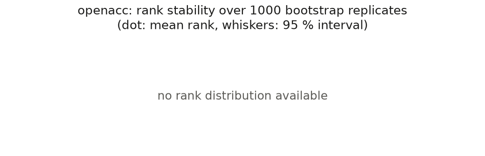

# FollowNet-2 leaderboard: openacc

Generated by `scripts/make_leaderboard.py` from `results/models` on 2026-10-12; definitions in `docs/leaderboard.md`, the checklist in `docs/checklist.md`. 3 decimals, `n/a` = not available.

Ranked entries (driver split, fold 0, seed 0): **8 admitted, 0 refused**; driver leak (`event` split): 8 admitted and 0 refused runs, listed apart and never ranked; run directories validated: 106, refused 0.

## Main table

Sorted by the whole-event P1 spacing error (the dataset has P1 only: no P2-P4, no composite). `[low, high]`: 95 % intervals over 1000 replicates (seed 0): driver bootstrap with common random numbers across models for P0 and P1 (per-event tables that reproduce their JSON summary). P0 ratio: RMSE_a(model) / RMSE_a(persistence). Fold spread: min-max over the clean arms of the paired split (probe events; the P0 ratio against persistence on the same events).

| model | family | P0 ratio [95% CI] | P1 10 s RMSE_s (m) [95% CI] | P1 30 s RMSE_s (m) [95% CI] | P1 whole RMSE_s (m) [95% CI] | P1 whole collision rate | P0 ratio fold spread | P1 whole fold spread (m) |
|---|---|---|---|---|---|---|---|---|
| gipps | mechanistic | 140.064 | 4.304 | 8.498 | 9.736 | 0.000 | [113.543, 143.816] | [7.298, 9.812] |
| idm | mechanistic | 71.317 | 4.933 | 9.859 | 11.186 | 0.000 | [54.338, 72.006] | [7.449, 11.619] |
| lstm_loop | network | 6.275 | 3.164 | 8.417 | 11.461 | 0.035 | [4.815, 6.500] | [7.506, 14.489] |
| ddpg | network | 82.349 | 10.155 | 13.294 | 13.593 | 0.012 | [65.095, 86.548] | [10.032, 14.299] |
| mlp_loop | network | 2.910 | 2.835 | 9.093 | 15.689 | 0.020 | [2.791, 2.952] | [6.530, 24.027] |
| lstm | network | 4.165 | 3.062 | 11.199 | 25.518 | 0.026 | [3.675, 4.336] | [14.287, 40.879] |
| mlp | network | 2.664 | 3.321 | 16.478 | 42.975 | 0.028 | [2.524, 2.835] | [23.827, 131.116] |
| persistence | baseline | 1.000 | 7.736 | 79.130 | 226.658 | 0.506 | [1.000, 1.000] | [176.282, 248.441] |

Notes:

* p0_ratio: no interval for ddpg, gipps, idm, lstm, lstm_loop, mlp, mlp_loop, persistence (persistence: test_p0.events.parquet: no table)
* p1_h10_rmse_s: no interval for ddpg, gipps, idm, lstm, lstm_loop, mlp, mlp_loop, persistence (p1.h10.parquet: no table)
* p1_h30_rmse_s: no interval for ddpg, gipps, idm, lstm, lstm_loop, mlp, mlp_loop, persistence (p1.h30.parquet: no table)
* p1_whole_rmse_s: no interval for ddpg, gipps, idm, lstm, lstm_loop, mlp, mlp_loop, persistence (test_closed_loop.events.parquet: no table)
* whole-event P1 rank: no rank distribution (driver replicates missing for ddpg, gipps, idm, lstm, lstm_loop, mlp, mlp_loop, persistence)
* driver leak event-fold0: p0_rmse_a: no interval for ddpg, gipps, idm, lstm, lstm_loop, mlp, mlp_loop, stability_mlp (test_p0.events.parquet: no table)
* driver leak event-fold0: p1_h10_rmse_s: no interval for ddpg, gipps, idm, lstm, lstm_loop, mlp, mlp_loop, stability_mlp (p1.h10.parquet: no table)
* driver leak event-fold0: p1_h30_rmse_s: no interval for ddpg, gipps, idm, lstm, lstm_loop, mlp, mlp_loop, stability_mlp (p1.h30.parquet: no table)
* driver leak event-fold0: p1_whole_rmse_s: no interval for ddpg, gipps, idm, lstm, lstm_loop, mlp, mlp_loop, stability_mlp (test_closed_loop.events.parquet: no table)

*Rank stability*: no rank distribution available.

## Driver leak (event split)

Runs under the `event` split share drivers between training and test (checklist rule 2): they are labelled "driver leak", listed apart and never ranked. Intervals: driver bootstrap over their own test part; the last column repeats the whole-event P1 error of the driver-split entry.

| model | family | label | run | P0 RMSE_a (m/s^2) [95% CI] | P1 10 s RMSE_s (m) [95% CI] | P1 30 s RMSE_s (m) [95% CI] | P1 whole RMSE_s (m) [95% CI] | P1 whole collision rate | P1 whole RMSE_s, driver split (m) |
|---|---|---|---|---|---|---|---|---|---|
| gipps | mechanistic | driver leak | event-fold0/gipps/seed0 | 4.158 | 3.911 | 7.014 | 8.370 | 0.001 | 9.736 |
| idm | mechanistic | driver leak | event-fold0/idm/seed0 | 2.005 | 4.804 | 9.282 | 10.478 | 0.000 | 11.186 |
| ddpg | network | driver leak | event-fold0/ddpg/seed0 | 2.631 | 9.507 | 12.238 | 12.790 | 0.001 | 13.593 |
| mlp_loop | network | driver leak | event-fold0/mlp_loop/seed0 | 0.093 | 2.603 | 8.005 | 12.933 | 0.030 | 15.689 |
| lstm_loop | network | driver leak | event-fold0/lstm_loop/seed0 | 0.175 | 3.052 | 11.775 | 15.223 | 0.037 | 11.461 |
| stability_mlp | network | driver leak | event-fold0/stability_mlp/seed0 | 0.358 | 3.610 | 18.128 | 27.084 | 0.023 | n/a |
| lstm | network | driver leak | event-fold0/lstm/seed0 | 0.128 | 3.571 | 29.454 | 63.279 | 0.023 | 25.518 |
| mlp | network | driver leak | event-fold0/mlp/seed0 | 0.082 | 3.556 | 24.300 | 65.291 | 0.043 | 42.975 |

## Transfer

Relative degradation `rmse_s(A -> B) / rmse_s(B -> B)` of the whole event (A: this dataset, B: the target; 1 = no loss) with 95 % driver-bootstrap intervals over the test drivers of B, and its mean over the targets with a ratio. Only admitted entries; the ratio is left out when the run trained on B is not admitted.

| model | family | -> follownet_highd | -> follownet_ngsim | -> ngsim | -> tgsim | -> waymo_hu | mean |
|---|---|---|---|---|---|---|---|
| gipps | mechanistic | 1.126 | 1.047 | 1.069 | 1.029 | 1.103 | 1.075 |
| idm | mechanistic | 1.519 | 1.182 | 1.259 | 1.180 | 1.437 | 1.316 |
| lstm_loop | network | 1.445 | 1.430 | 1.064 | 0.763 | 1.097 | 1.160 |
| ddpg | network | 0.948 | 0.932 | 1.008 | 0.972 | 1.004 | 0.973 |
| mlp_loop | network | 1.053 | 1.436 | 1.334 | 1.304 | 1.127 | 1.251 |
| lstm | network | 1.132 | 1.177 | 0.087 | 0.019 | 1.192 | 0.721 |
| mlp | network | 0.955 | 0.956 | 0.917 | 0.120 | 0.753 | 0.740 |
| persistence | baseline | 1.000 | 1.000 | 1.000 | 1.000 | 1.000 | 1.000 |

* gipps -> follownet_highd: p1_follownet_highd.whole.parquet: no table; p1.whole.parquet: no table
* gipps -> follownet_ngsim: p1_follownet_ngsim.whole.parquet: no table; p1.whole.parquet: no table
* gipps -> ngsim: p1_ngsim.whole.parquet: no table; p1.whole.parquet: no table
* gipps -> tgsim: p1_tgsim.whole.parquet: no table; p1.whole.parquet: no table
* gipps -> waymo_hu: p1_waymo_hu.whole.parquet: no table; p1.whole.parquet: no table
* idm -> follownet_highd: p1_follownet_highd.whole.parquet: no table; p1.whole.parquet: no table
* idm -> follownet_ngsim: p1_follownet_ngsim.whole.parquet: no table; p1.whole.parquet: no table
* idm -> ngsim: p1_ngsim.whole.parquet: no table; p1.whole.parquet: no table
* idm -> tgsim: p1_tgsim.whole.parquet: no table; p1.whole.parquet: no table
* idm -> waymo_hu: p1_waymo_hu.whole.parquet: no table; p1.whole.parquet: no table
* lstm_loop -> follownet_highd: p1_follownet_highd.whole.parquet: no table; p1.whole.parquet: no table
* lstm_loop -> follownet_ngsim: p1_follownet_ngsim.whole.parquet: no table; p1.whole.parquet: no table
* lstm_loop -> ngsim: p1_ngsim.whole.parquet: no table; p1.whole.parquet: no table
* lstm_loop -> tgsim: p1_tgsim.whole.parquet: no table; p1.whole.parquet: no table
* lstm_loop -> waymo_hu: p1_waymo_hu.whole.parquet: no table; p1.whole.parquet: no table
* ddpg -> follownet_highd: p1_follownet_highd.whole.parquet: no table; p1.whole.parquet: no table
* ddpg -> follownet_ngsim: p1_follownet_ngsim.whole.parquet: no table; p1.whole.parquet: no table
* ddpg -> ngsim: p1_ngsim.whole.parquet: no table; p1.whole.parquet: no table
* ddpg -> tgsim: p1_tgsim.whole.parquet: no table; p1.whole.parquet: no table
* ddpg -> waymo_hu: p1_waymo_hu.whole.parquet: no table; p1.whole.parquet: no table
* mlp_loop -> follownet_highd: p1_follownet_highd.whole.parquet: no table; p1.whole.parquet: no table
* mlp_loop -> follownet_ngsim: p1_follownet_ngsim.whole.parquet: no table; p1.whole.parquet: no table
* mlp_loop -> ngsim: p1_ngsim.whole.parquet: no table; p1.whole.parquet: no table
* mlp_loop -> tgsim: p1_tgsim.whole.parquet: no table; p1.whole.parquet: no table
* mlp_loop -> waymo_hu: p1_waymo_hu.whole.parquet: no table; p1.whole.parquet: no table
* lstm -> follownet_highd: p1_follownet_highd.whole.parquet: no table; p1.whole.parquet: no table
* lstm -> follownet_ngsim: p1_follownet_ngsim.whole.parquet: no table; p1.whole.parquet: no table
* lstm -> ngsim: p1_ngsim.whole.parquet: no table; p1.whole.parquet: no table
* lstm -> tgsim: p1_tgsim.whole.parquet: no table; p1.whole.parquet: no table
* lstm -> waymo_hu: p1_waymo_hu.whole.parquet: no table; p1.whole.parquet: no table
* mlp -> follownet_highd: p1_follownet_highd.whole.parquet: no table; p1.whole.parquet: no table
* mlp -> follownet_ngsim: p1_follownet_ngsim.whole.parquet: no table; p1.whole.parquet: no table
* mlp -> ngsim: p1_ngsim.whole.parquet: no table; p1.whole.parquet: no table
* mlp -> tgsim: p1_tgsim.whole.parquet: no table; p1.whole.parquet: no table
* mlp -> waymo_hu: p1_waymo_hu.whole.parquet: no table; p1.whole.parquet: no table
* persistence -> follownet_highd: p1_follownet_highd.whole.parquet: no table; p1.whole.parquet: no table
* persistence -> follownet_ngsim: p1_follownet_ngsim.whole.parquet: no table; p1.whole.parquet: no table
* persistence -> ngsim: p1_ngsim.whole.parquet: no table; p1.whole.parquet: no table
* persistence -> tgsim: p1_tgsim.whole.parquet: no table; p1.whole.parquet: no table
* persistence -> waymo_hu: p1_waymo_hu.whole.parquet: no table; p1.whole.parquet: no table

## Refused entries

None: every run directory of the dataset has a complete checklist.

## Provenance

* **data version**: reconstructed
* **reconstruction method**: qp-semi-implicit-v1
* **split**: driver, fold 0, training seed 0 (checklist split type: driver)
* **seeds**: checklist: global 0, split 0, train 0; seed spread: none; fold spread: clean arms of folds 0-4
* **git revision of the runs**: training: d22e57347fa67c023ea3e8c0315e2a4093772485; protocols: d22e57347fa67c023ea3e8c0315e2a4093772485
* **protocol configuration hashes**: p1: e742be505ac0; p1_follownet_highd: 73bf244e536b; p1_follownet_ngsim: 6c82837f4191; p1_ngsim: 9de8b9140df1; p1_tgsim: 31f832d3b61a; p1_waymo_hu: cd1e81ad64a8
* **bootstrap**: 1000 replicates, seed 0: drivers for P0 and P1 (common random numbers), in-range P2 profiles, P3 speeds with an equilibrium and training seeds for the composite rank (Generator [0, 1])
* **date**: 2026-10-12
